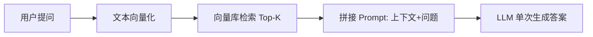
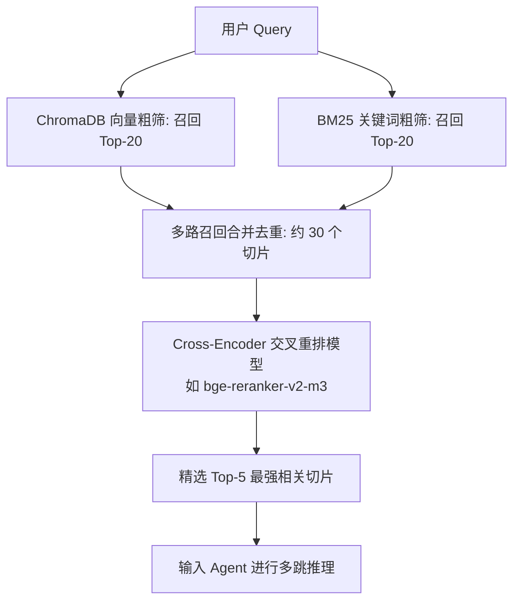
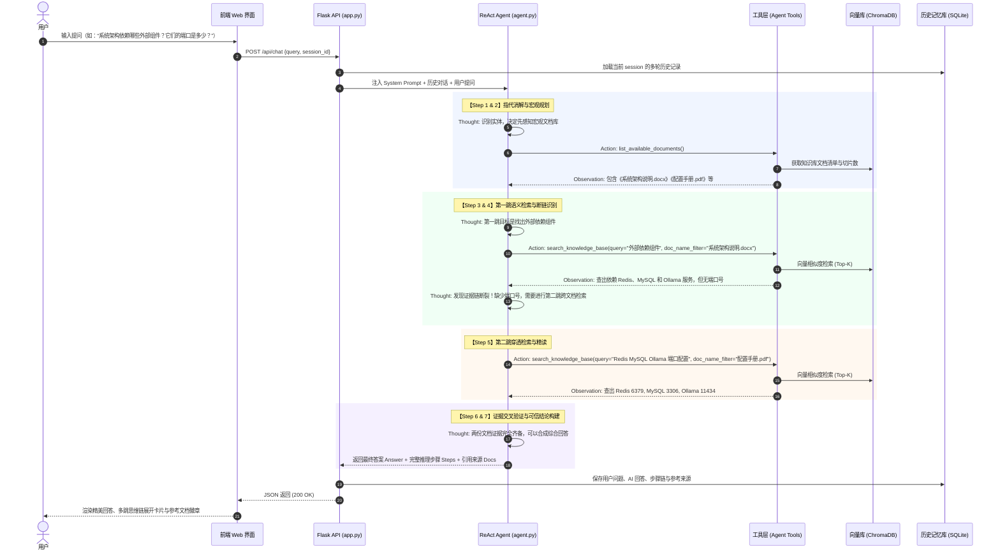

# Agentic RAG 企业智能知识库系统：召回、重排与智能体执行全流程深度解析

---

## 目录
1. [传统 RAG 与 Agentic RAG 的本质区别](#1-传统-rag-与-agentic-rag-的本质区别)
2. [召回（Retrieval）与重排（Reranking）的核心原理与本项目实现](#2-召回retrieval与重排reranking的核心原理与本项目实现)
   - [2.1 什么是召回（Retrieval）？](#21-什么是召回retrieval)
   - [2.2 本项目的初阶召回：BGE-M3 + ChromaDB](#22-本项目的初阶召回bge-m3--chromadb)
   - [2.3 什么是重排（Reranking）？](#23-什么是重排reranking)
   - [2.4 本项目的“认知级动态重排”机制](#24-本项目的认知级动态重排机制)
   - [2.5 业界常见重排方案扩展（Cross-Encoder / BGE-Reranker）](#25-业界常见重排方案扩展cross-encoder--bge-reranker)
3. [Agent 执行问答的每一步端到端全流程拆解](#3-agent-执行问答的每一步端到端全流程拆解)
   - [Step 1：请求接入与多轮对话指代消解（Coreference Resolution）](#step-1请求接入与多轮对话指代消解coreference-resolution)
   - [Step 2：宏观感知与检索规划（Macro Awareness）](#step-2宏观感知与检索规划macro-awareness)
   - [Step 3：第一跳语义检索与事实观察（First-Hop Retrieval）](#step-3第一跳语义检索与事实观察first-hop-retrieval)
   - [Step 4：证据缺口分析与多跳触发决策（Gap Analysis）](#step-4证据缺口分析与多跳触发决策gap-analysis)
   - [Step 5：定向穿透与连续上下文精读（Second-Hop & Deep Read）](#step-5定向穿透与连续上下文精读second-hop--deep-read)
   - [Step 6：冲突比对、多源融合与去幻觉校验（Synthesis & Fact-Checking）](#step-6冲突比对多源融合与去幻觉校验synthesis--fact-checking)
   - [Step 7：格式化结构输出与证据链溯源绑定（Structured Response）](#step-7格式化结构输出与证据链溯源绑定structured-response)
4. [核心相关技术与知识点全景剖析](#4-核心相关技术与知识点全景剖析)
   - [4.1 双塔模型（Bi-Encoder）vs 交叉编码器（Cross-Encoder）](#41-双塔模型bi-encoder-vs-交叉编码器cross-encoder)
   - [4.2 向量嵌入模型（Embedding）与 BGE-M3 特性](#42-向量嵌入模型embedding与-bge-m3-特性)
   - [4.3 向量检索距离度量（Cosine / L2 / IP）与 HNSW 索引](#43-向量检索距离度量cosine--l2--ip与-hnsw-索引)
   - [4.4 ReAct 范式（Reasoning + Acting）底层机制](#44-react-范式reasoning--acting底层机制)
   - [4.5 大模型工具调用（Tool Calling / Function Calling）机制](#45-大模型工具调用tool-calling--function-calling机制)
   - [4.6 语义切片分块策略（Chunking Strategy）](#46-语义切片分块策略chunking-strategy)
   - [4.7 内容哈希防重机制与知识库生命周期更新（Content Hash Deduplication）](#47-内容哈希防重机制与知识库生命周期更新content-hash-deduplication)
5. [系统架构与时序图](#5-系统架构与时序图)

---

## 1. 传统 RAG 与 Agentic RAG 的本质区别

传统朴素 RAG（Naive RAG）是一个**单向静态流水线**：


### 传统 RAG 的致命痛点：
1. **“一锤子买卖”无法处理复杂多跳问题**：若回答问题需要先查《系统架构书》得知某依赖组件名，再查《接口手册》找配置参数，传统 RAG 单次检索极易漏掉第二份文档；
2. **检索词僵化**：用户提问常带口语化、代词（“它”、“这个系统”），直接拿模糊输入做向量匹配，召回精度急剧下降；
3. **缺乏反思能力**：若检索到的片段不包含答案，传统 RAG 无法察觉，往往直接基于无关片段胡编乱造（幻觉）。

### Agentic RAG 的解法：
将 LLM 升级为一个**具有自主规划、工具调用、自我反思、多步验证能力的智能体（Agent）**：
- 能够**改写检索词**；
- 能够**自主决定查全库还是查单篇**；
- 发现证据不足时，**自动发起第二跳、第三跳迭代追查**；
- 最终汇聚所有证据链，并标注来源出处。

---

## 2. 召回（Retrieval）与重排（Reranking）的核心原理与本项目实现

### 2.1 什么是召回（Retrieval）？
**召回**是在海量候选集（成千上万个文档切片）中，以**极高速度**粗筛出与查询最相关的几十个或几个候选候选片段的过程。

- **核心目标**：保证**查全率（Recall）**，宁可少量多带，不能漏掉真正有用的关键切片。
- **主流方式**：
  - **稠密向量召回（Dense Retrieval）**：通过 Embedding 模型将文本映射为连续向量，计算余弦相似度或欧氏距离；
  - **稀疏关键词召回（Sparse Retrieval）**：如 BM25、TF-IDF，基于词频精准命中专有名词；
  - **混合召回（Hybrid Retrieval）**：向量检索 + BM25 融合（RRF / 权重融合）。

### 2.2 本项目的初阶召回：BGE-M3 + ChromaDB
在本项目中，召回由 `vector_store.py` 中的 `query_similar_chunks` 完成：

1. **向量化编码**：调用部署在本地 Ollama 的 `BAAI/bge-m3` 模型，将用户的 Query 编码为 1024 维的高维浮点向量；
2. **向量空间相似度检索**：
   ```python
   # ChromaDB 向量检索
   results = self.collection.query(
       query_embeddings=[query_vector],
       n_results=top_k,
       where=where_filter,  # 支持针对指定 doc_name 元数据精确过滤
       include=["documents", "metadatas", "distances"]
   )
   ```
3. **混合过滤**：支持基于元数据（`doc_name`）的精准下钻过滤。当 Agent 明确已知目标在某篇文档时，自动收窄检索范围，彻底消除其他文档的噪声干扰。

### 2.3 什么是重排（Reranking）？
**重排**是在召回出的少数候选片段（例如 Top-20）中，使用计算复杂度更高、语义理解更细腻的模型，对片段与问题的匹配度进行**精细打分与重新排序**，挑选出最核心的 Top-N（如 Top-3）输入大模型。

- **为什么需要重排？**
  - 双塔向量模型（Bi-Encoder）在编码 Query 和 Document 时是彼此独立的，缺乏字与字之间的深度交叉注意力（Cross-Attention）；
  - 向量相似度高往往只代表“话题接近”，并不代表该段落真的“正面回答了问题”；
  - 重排器能识别出“字面相似但逻辑不符”与“表达完全不同但逻辑强相关”的深层关系。

### 2.4 本项目的“认知级动态重排”机制
在传统流水线中，重排是由一个独立的轻量模型（如 `bge-reranker-large`）计算一个标量分数实现的。而在本项目中，采用了更为先进的 **Agentic 认知级重排（Cognitive / Generative Reranking）**：

1. **Agent 自主审查过滤（Observation Review）**：
   - 向量库召回切片后，Agent（DeepSeek-V3）以完整的思考步骤对切片进行理解与评分；
   - 若发现召回片段内容零散、未触及核心，Agent 会**自主在思维链中废弃该片段**，绝不盲目引用；
2. **连续上下文补充阅读（Read Continuous Chunks）**：
   - 当向量召回的单一切片（Chunk）跨度有限导致逻辑断层时，Agent 会主动调用 `read_specific_document(doc_name, max_chunks=6)` 工具，按照 `chunk_index` 升序获取该文档连续的上下文段落，实现了从“点状召回”到“篇章级连贯理解”的升级。

### 2.5 业界常见重排方案扩展（Cross-Encoder / BGE-Reranker）
若后续希望在纯向量召回和 Agent 思考之间再叠加一层纯算法重排器，常见的落地架构为：



### 2.6 方案 B：字符图与 ASCII 架构图“智能升维重构”预处理机制（已落地）
针对技术文档中常见的 ASCII 框图（如 `┌─┐│└┘`、多栏并排盒子拓扑图），传统 RAG 会将其拆解为无序线条，导致并排文字行间交错。本项目在 `DocumentParser` 中正式落地了**方案 B（智能升维重构）**：

1. **自动模式探针（Diagram Detection）**：
   - 扫描文档文本中出现的制表字符（`┌`、`─`、`│`、`▼`、`┼` 等）；
   - 当检测到密集的字符拓扑图时，自动定位被包裹的代码块或连续框线段落。
2. **LLM 语义转写（Semantic Transcription）**：
   - 调用预处理引擎（DeepSeek-V3, `temperature=0.0`），将复杂的 2D 字符图升维重构为**结构化 Markdown 层级说明**，并自动附带标准 **Mermaid 流程图**；
   - 彻底剔除无意义的框线符号噪音，并将并排两栏的交错文字拆解为标准树状上下游关系。
3. **弹性平滑降级（Graceful Fallback）**：
   - 若遇到离线或网络波动，自动启用降级规则清洗器，剥除纯框线行并规整首尾多余竖线，保障入库 100% 稳定运行。

---

## 3. Agent 执行问答的每一步端到端全流程拆解

本项目采用经典的 **ReAct（Reasoning + Acting）** 智能体范式，由 DeepSeek-V3 驱动。整个问答过程分为七个严密的步骤：



### 详细步骤说明：

#### Step 1：请求接入与多轮对话指代消解（Coreference Resolution）
- **痛点**：若用户追问：“那它的端口是多少？”，直接拿“它的端口是多少”去向量库检索几乎无法匹配到结果。
- **机制**：Prompt 中特别定义了指代消解规范。Agent 会先将用户提问与历史会话（`chat_history`）比对，在思维链中自动把代词重写为明确具名实体（如改写为 `Redis MySQL 端口`），杜绝模糊检索。

#### Step 2：宏观感知与检索规划（Macro Awareness）
- **机制**：如果用户提问涵盖宽泛概念（如“各方案之间的优缺点对比”），Agent 先调用 `list_available_documents()` 工具。
- **结果**：获取当前库中包含哪些文件，避免在未知文档边界的情况下盲目全库抓取。

#### Step 3：第一跳语义检索与事实观察（First-Hop Retrieval）
- **机制**：Agent 构造首轮查询词，调用 `search_knowledge_base`。
- **输入**：针对目标问题生成独立高质量 Query，支持选择性传入 `doc_name_filter` 进行定向精细查询。
- **返回**：格式化呈现的片段、来源文档、切片序号与欧氏距离评分。

#### Step 4：证据缺口分析与多跳触发决策（Gap Analysis）
- **核心逻辑**：Agent 进入反思状态，比对【当前收集到的证据】与【用户的核心问题】。
- **判断**：
  - 若信息充分：直接跳往最终合成步骤；
  - 若信息缺失或出现跨文档交叉引用（例如文档提到了“详见接口规范”）：触发多跳检索（Next Hop），生成新的目标查询词。

#### Step 5：定向穿透与连续上下文精读（Second-Hop & Deep Read）
- **多跳穿透**：针对缺口字段，带着上一跳的发现作为已知条件，检索第二份或第三份文档；
- **连续精读**：若某章节公式或步骤连贯性极强，调用 `read_specific_document` 连续抓取相邻切片，彻底消除碎片化切块对阅读理解的影响。

#### Step 6：冲突比对、多源融合与去幻觉校验（Synthesis & Fact-Checking）
- **防幻觉策略**：Prompt 强制要求“一切结论必须严格来源于检索证据，未提及的诚实回答未知”；
- **冲突裁决**：当多份文档对同一指标存在版本差异时，标注不同文档的观点（如：“依据《旧版文档》为 X，但在《新版规划》中调整为 Y”）。

#### Step 7：实时流式输出与思维链打字机渲染（SSE Streaming & Typewriter）
- **流式通信协议**：采用标准 **Server-Sent Events (SSE)** 长连接技术，彻底替代传统的单次阻塞等待；
- **双线程队列解耦**：服务端通过 `StreamCallbackHandler` 挂载在 LangChain 思考循环中，通过线程安全队列 `Queue` 异步实时捕获并推送三类关键事件：
  - `event: step_start`：实时通知前端 Agent 正在调用的工具名与查询参数；
  - `event: step_end`：实时推送外部工具执行返回的摘要片段；
  - `event: token`：在最终生成阶段，实时逐字吐出 DeepSeek 生成的 Markdown 文本；
  - `event: done`：全流程结束，推送引用文档集合并触发 SQLite 会话持久化落盘。
- **前端交互效果**：
  1. 用户提问后即刻看到 Agent 动态思考状态；
  2. 答案如打字机般实时逐字流式渲染；
  3. 回答完毕后，思考推理过程自动优雅折叠为卡片，同时附带参考文档来源徽章。

---

## 4. 核心相关技术与知识点全景剖析

### 4.1 双塔模型（Bi-Encoder）vs 交叉编码器（Cross-Encoder）

| 维度 | 双塔模型 (Bi-Encoder / Embedding) | 交叉编码器 (Cross-Encoder / Reranker) |
| :--- | :--- | :--- |
| **典型代表** | BGE-M3, OpenAI text-embedding-3, BERT | bge-reranker-large, Cohere Rerank |
| **计算架构** | Query 与 Document 分别经过独立的 Transformer 编码，产出固定维度的独立向量。 | Query 与 Document 拼接成一条文本 `[CLS] Query [SEP] Doc`，同时送入 Transformer。 |
| **注意力机制** | 仅在各自文本内部做 Self-Attention，Query 与 Doc 之间**无交互**。 | Query 与 Doc 的每个词之间**全量交叉做 Cross-Attention**，语义交互极深。 |
| **计算速度** | 极快。文档向量可预先离线计算并建立索引，在线检索仅需计算向量内积（毫秒级）。 | 较慢。必须对每对 `(Query, Doc)` 组合做完整的深度前向传播，计算量随候选数线性增加。 |
| **适用阶段** | **第一阶段：海量初筛召回（Retrieval）** | **第二阶段：精细重排序（Reranking）** |

---

### 4.2 向量嵌入模型（Embedding）与 BGE-M3 特性

本项目采用由智源研究院（BAAI）开源的 **`BAAI/bge-m3`**：
1. **Multi-Linguality（多语言通用）**：原生支持中英跨语言混合检索与代码检索，特别适合中文技术文档与企业内网资料；
2. **Multi-Granularity（多粒度长文本）**：支持高达 **8192** 字符的上下文输入，即使长段落切片也不会出现截断溢出；
3. **Multi-Functionality（三合一特征支持）**：具备稠密向量（Dense）、多向量匹配（ColBERT-style Multi-Vector）与稀疏词权重（Sparse Lexical）的三重表征能力。

---

### 4.3 向量检索距离度量（Cosine / L2 / IP）与 HNSW 索引

在 ChromaDB 中，高维向量通过**空间距离度量**衡量语义接近程度：

1. **余弦相似度 (Cosine Similarity)**：
   $$\text{Cosine}(A, B) = \frac{A \cdot B}{\|A\| \|B\|}$$
   - 关注向量的方向夹角，**不受文本长短绝对值的影响**，常用于归一化后的文本检索。
2. **欧氏距离 (L2 Squared Distance)**：
   $$D(A, B) = \sum_{i=1}^n (A_i - B_i)^2$$
   - 空间直线几何距离，数值**越小表示越相似**（本项目 ChromaDB 默认输出即为欧氏距离）。
3. **HNSW 索引算法（Hierarchical Navigable Small World）**：
   - ChromaDB 底层默认构建的分层导航可小世界图算法；
   - 突破了朴素暴力遍历（Flat Scan）的高延迟瓶颈，实现近线性对数级 $O(\log N)$ 的超高速近似最近邻搜索（ANN）。

---

### 4.4 ReAct 范式（Reasoning + Acting）底层机制

ReAct（由 Yao et al., 2022 提出）将大模型的决策建模为交替进行的循环：

$$\text{Thought} \longrightarrow \text{Action} \longrightarrow \text{Observation} \longrightarrow \text{Thought} \dots \longrightarrow \text{Finish}$$

- **Thought（推理规划）**：大模型内省当前所知与未知，拆解子目标（“我需要先查文档 X”）；
- **Action（执行动作）**：大模型生成结构化工具调用（Tool Call Name + Arguments）；
- **Observation（外部观察）**：执行工具并将真实外部返回（向量库结果、API 数据）作为新的上下文回喂给大模型；
- **价值**：大模型不再盲目单步回答，而是具备了**“试错、校准、二次探索”**的自省智能。

---

### 4.5 大模型工具调用（Tool Calling / Function Calling）机制

本项目使用 LangChain 的 `create_tool_calling_agent`，其底层通信规范如下：

1. **Schema 注册**：在向 DeepSeek API 发送请求时，LangChain 会将每个 `@tool` 修饰的 Python 函数（包括函数名、类型签名、Docstring 参数说明）自动转换为 OpenAI 兼容的标准 JSON Schema：
   ```json
   {
     "type": "function",
     "function": {
       "name": "search_knowledge_base",
       "description": "在知识库中进行语义相似度向量检索...",
       "parameters": {
         "type": "object",
         "properties": {
           "query": {"type": "string", "description": "检索查询词"},
           "doc_name_filter": {"type": "string", "description": "可选文档名过滤"}
         },
         "required": ["query"]
       }
     }
   }
   ```
2. **大模型结构化响应**：当 DeepSeek 判定需要查库时，它不输出正文，而是输出专用的 `tool_calls` 结构；
3. **本地拦截与分发**：Python 服务端捕获该 `tool_calls`，在本地安全调用 `vector_store` 方法，并将执行结果作为 `ToolMessage` 再次发送回大模型。

---

### 4.6 语义切片分块策略（Chunking Strategy）

文本切片是决定 RAG 表现上限的基础设施：
- **切片过大（如 > 2000 字）**：向量表达过于模糊宽泛，检索相关性稀释，且容易超出 LLM 最佳上下文；
- **切片过小（如 < 100 字）**：缺乏上下文主谓宾，碎片化严重，导致大模型无法推断语义；
- **本项目黄金配比**：
  - **`chunk_size = 600`**：保持在 400~800 字符内，刚好是一个完整自然段或一个功能定义的跨度；
  - **`chunk_overlap = 100`**：保留 100 字符重叠滑动窗口，**确保处于边缘的关键实体、跨句指代不会被硬生生切断**；
  - **递归优先级切分**：`["\n\n", "\n", "。", "！", "？", "；", " ", ""]`，绝不在句子中间打断。

---

### 4.7 内容哈希防重机制与知识库生命周期更新（Content Hash Deduplication）

在企业级生产环境中，知识库维护面临两大普遍挑战：
1. **同内容不同名（副本泛滥）**：同一份规章制度或技术文档，不同团队在上传时可能被命名为 `规范v1.docx`、`公司最新规范.docx` 或 `规范最终版_副本.docx`；若仅按文件名防重，向量库中将充斥数倍的完全冗余切片，造成索引臃肿并使召回被冗余切片霸占；
2. **同名文档更新（版本迭代）**：文档修改后重新上传，若不清理旧切片直接写入，库内将同时存在新旧两个相互矛盾的版本，导致 LLM 回答产生严重的事实混乱。

#### 4.7.1 SHA-256 内容指纹防重逻辑
本项目在 `VectorStoreManager.process_and_add_document` 中引入了基于 **SHA-256 内容哈希** 的防重过滤网：

```python
# 1. 提取全文清洗后的文本，计算高灵敏度 SHA-256 指纹
content_hash = hashlib.sha256(raw_text.strip().encode("utf-8")).hexdigest()

# 2. 查询 ChromaDB 元数据索引库，毫秒级快速匹配
existing_matches = self.collection.get(
    where={"content_hash": content_hash},
    include=["metadatas"]
)
```

#### 4.7.2 三大典型业务场景的处理策略

| 业务场景 | 判定条件 | 触发动作 | 终端日志提示 |
| :--- | :--- | :--- | :--- |
| **场景 A：同内容不同文件名（副本上传）** | `content_hash` 一致，但 `doc_name != existing_doc_name` | **立即拦截并跳过入库**：不计算 Embedding，不写向量库，直接返回查重提醒，避免知识库冗余膨胀。 | `⚠️ [内容哈希查重拦截] 文件【B.docx】与已入库文档【A.docx】内容完全一致 (SHA-256: xxx)，跳过重复写入！` |
| **场景 B：同名相同文件重复上传** | `content_hash` 一致，且 `doc_name == existing_doc_name` | **复用已有索引**：无需重新切片与调用 Ollama 向量模型，极大节省算力与响应耗时。 | `ℹ️ [内容未变更] 文档【A.docx】内容与库内现有版本完全一致，无需重复计算向量。` |
| **场景 C：同名文件内容变更（文档更新）** | `doc_name` 相同，但 `content_hash` 不一致 | **版本覆盖写入**：自动调用 `self.delete_document(doc_name, delete_file=False)` 先彻底擦除旧切片及向量，再写入新版切片。 | `🗑️ [文档删除成功] 已清空【A.docx】旧切片 -> 📄 [开始处理文档] (新 SHA-256)` |

#### 4.7.3 全链路可观测性终端日志
为了让运维人员和开发者实时洞悉系统运行状态，系统在以下关键节点输出了统一格式的表情符号日志：
- `📥 [接收上传文件]`：显示文件名与文件物理大小；
- `🧩 [触发大模型数据清洗]` / `🤖 [大模型数据清洗]`：显示检测到的字符架构图特征数、调用 DeepSeek-V3 升维重构进度与重构耗时统计；
- `💡 [查重处理结果]`：报告 SHA-256 指纹比对拦截情况；
- `✂️ [分块切分完成]`：显示切片总数、单块大小与重叠窗口；
- `🧠 [计算向量]`：显示调用 Ollama bge-m3 的批处理状态；
- `🔍 [向量相似度检索]` / `🎯 [检索命中完成]`：显示检索范围、查询词、Top-K 及相关度距离；
- `🤖 [收到问答请求]` / `✨ [问答流式输出完毕]`：显示会话 ID、问题、字符统计与引用出处。

---

## 5. 系统架构总览图

```
┌────────────────────────────────────────────────────────────────────────┐
│                        前端交互层 (HTML / JS / CSS)                    │
│   - 多格式文件拖拽上传 (.pptx, .docx, .pdf, .txt, .md, .csv)          │
│   - 多会话持久化管理 & Markdown 流式/富文本渲染                       │
│   - Agent 思考轨迹 (Reasoning Steps) 交互式展开折叠卡片                │
└────────────────────────────────────┬───────────────────────────────────┘
                                     │ HTTP RESTful API
┌────────────────────────────────────▼───────────────────────────────────┐
│                       服务端接入层 (Flask API: app.py)                  │
│   - /api/upload: 上传接收与入库流水线调度                              │
│   - /api/chat: 智能问答接口，挂载历史会话                             │
│   - /api/sessions: SQLite 会话与历史消息持久化                         │
└───────────────────┬────────────────────────────────┬───────────────────┘
                    │                                │
┌───────────────────▼──────────────┐   ┌─────────────▼───────────────────┐
│  离线入库与清洗 (vector_store.py) │   │ 智能中枢 Agent (agent.py)        │
│  - DocumentParser 多源文本清洗   │   │  - DeepSeek-V3 Tool Calling 引擎│
│    (docx/pdf/pptx/txt 结构化抽取)│   │  - ReAct 规划与多跳穿透推理     │
│  - 递归标点感知分块 (600/100)    │   │  - 指代消解与检索词自主改写     │
│  - Ollama BGE-M3 向量嵌入批量计算│   │  - 多文档证据链交叉校验         │
│  - ChromaDB 持久化集合维护       │   └─────────────┬───────────────────┘
└───────────────────┬──────────────┘                 │
                    │ 工具调用 (Tools)               │
                    └────────────────────────────────┘
                                     │
┌────────────────────────────────────▼───────────────────────────────────┐
│                         底层数据与模型存储层                            │
│   - 向量数据库: ChromaDB (本地持久化，内嵌 HNSW 索引)                  │
│   - 嵌入模型服务: Ollama (本地部署 BAAI/bge-m3, 1024 维向量)           │
│   - 推理大模型: DeepSeek-V3 API (温度 0.2，具备强大 Tool-Calling 能力) │
│   - 关系型存储: SQLite (chat_history.db 会话与消息持久化)              │
│   - 本地文件库: uploads/ (原始文件保真存档)                            │
└────────────────────────────────────────────────────────────────────────┘
```

---
*本文档为 Agentic RAG 系统深度技术白皮书，全面涵盖召回、重排、数据清洗与多跳智能体全生命周期。*
