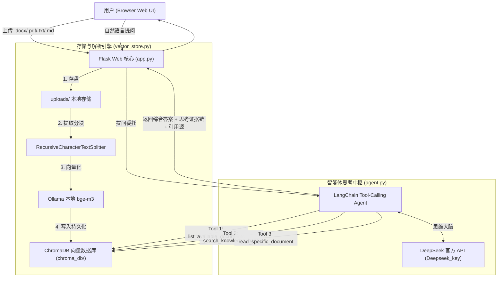

# Agentic RAG - 企业智能多文档关联知识库系统

> **项目定位**：基于 **方案一（Agentic RAG / 智能体工具调用循环）** 独立全新构建，专为解决**“多篇文档相互依赖、概念穿透引用、跨文档多跳推理（Multi-Hop Reasoning）”**而设计。与旧项目完全解耦，具备独立的架构设计、模型中心、持久化向量存储与全栈 Web 交互界面。

---

## 目录
- [一、 核心背景与为什么选择 Agentic RAG](#一-核心背景与为什么选择-agentic-rag)
- [二、 系统架构图与交互时序](#二-系统架构图与交互时序)
- [三、 技术栈与组件清单](#三-技术栈与组件清单)
- [四、 目录结构一览](#四-目录结构一览)
- [五、 各模块代码详细解读](#五-各模块代码详细解读)
  - [1. models.py (模型配置中心)](#1-modelspy-模型配置中心)
  - [2. vector_store.py (向量库与文档解析)](#2-vector_storepy-向量库与文档解析)
  - [3. agent.py (智能体多跳检索引擎)](#3-agentpy-智能体多跳检索引擎)
  - [4. app.py (Flask Web 服务与 API)](#4-apppy-flask-web-服务与-api)
  - [5. templates/index.html (前端交互界面)](#5-templatesindexhtml-前端交互界面)
- [六、 环境依赖与快速启动指南](#六-环境依赖与快速启动指南)

---

## 一、 核心背景与为什么选择 Agentic RAG

在常规的企业知识库中，文档往往不是孤立存在的。例如：
- 《系统架构规范.docx》定义了微服务名称与协议规则；
- 《订单模块详细设计.pdf》中引用了上述服务，但只简单提及了参数名称；
- 《错误码与容灾手册.md》则详细解释了上述调用异常的降级逻辑。

### 传统单次 RAG (Naive RAG) 的瓶颈
传统单次向量检索只是把用户问题与全部文本切片做一次余弦相似度计算，往往只能命中其中一个文档的碎片，**无法自主发现线索并跨文档追踪补充信息**，导致回答“管中窥豹、缺乏全局关联”。

### 方案一 Agentic RAG 的解决之道
把文档检索包装为大模型的**工具（Tools）**，赋予大模型 **ReAct（Thought -> Action -> Observation）循环推理能力**：
1. **宏观视野**：Agent 先了解知识库包含哪些候选文档；
2. **多跳检索（Multi-Hop）**：Agent 在文档 A 中检索到概念后，发现涉及文档 B，主动发起第 2 次定向检索查询文档 B；
3. **证据链汇聚**：收集齐所有跨文档证据后，综合输出逻辑闭环的高质量回答，并在前端完整展示思考轨迹。

---

## 二、 系统架构图与交互时序

### 1. 系统整体架构



### 2. 问答推理时序图（以跨文档关联为例）

```mermaid
sequenceDiagram
    autonumber
    actor User as 用户
    participant Web as 前端交互界面
    participant Agent as Agent 智能体 (DeepSeek)
    participant Tools as 知识库工具库
    participant Chroma as ChromaDB + bge-m3

    User->>Web: 提问：“方案A与方案B的接口通信方式有何区别？”
    Web->>Agent: 发起 POST /api/chat
    Agent->>Tools: 调用 list_available_documents()
    Tools-->>Agent: 返回 ["方案A_设计.docx", "方案B_设计.pdf", ...]
    
    rect rgb(30, 40, 60)
        Note over Agent, Chroma: 【第 1 跳：检索方案A】
        Agent->>Tools: search_knowledge_base(query="接口通信 协议", doc_name="方案A_设计.docx")
        Tools->>Chroma: 向量语义相似度搜索
        Chroma-->>Tools: 命中文档A切片：“采用 gRPC 通信，序列化协议为 Protobuf...”
        Tools-->>Agent: 返回方案A片段
    end

    rect rgb(40, 50, 70)
        Note over Agent, Chroma: 【第 2 跳：穿透检索方案B】
        Agent->>Tools: search_knowledge_base(query="接口通信 协议", doc_name="方案B_设计.pdf")
        Tools->>Chroma: 向量语义相似度搜索
        Chroma-->>Tools: 命中文档B切片：“采用 HTTP/RESTful 通信，数据格式为 JSON...”
        Tools-->>Agent: 返回方案B片段
    end

    Agent->>Agent: 综合比对两者差异，形成最终结论
    Agent-->>Web: 返回：分析回答 + 思考步骤链条 (Steps) + 参考文档
    Web-->>User: 渲染精美回答并展示可折叠的【思考过程与证据链】
```



---

## 三、 技术栈与组件清单

| 层级 | 核心组件 | 版本/规范 | 说明 |
| :--- | :--- | :--- | :--- |
| **LLM 大脑** | DeepSeek (`deepseek-flash`) | OpenAI 兼容协议 (`https://api.deepseek.com`) | 默认指定 `deepseek-flash` 模型，原生支持 Tool Calling 工具调用与多跳规划 |
| **本地向量模型** | Ollama `bge-m3` | 本地服务 (`:11434`) | BAAI 高性能多语言向量模型，支持 8192 长文本与密集检索 |
| **向量数据库** | ChromaDB | 持久化模式 | 存储切片正文、向量索引与多维元数据 (`doc_name`, `chunk_index` 等) |
| **智能体框架** | LangChain / LangChain Core | `>=0.2.0` | 构建 `create_tool_calling_agent` 与执行器 |
| **后端 Web 框架** | Flask | `>=3.0.0` | 提供文件流上传、文档生命周期管理与对话接口 |
| **前端交互界面** | Vanilla HTML5 + CSS3 + JS | 现代化暗色拟态 | 零外部复杂框架，开箱即用，支持拖拽上传、思维链折叠展示 |

---

## 四、 目录结构一览

```
e:/RAG_project/Agentic_RAG/
│
├── models.py             # 模型配置中心 (DeepSeek 密钥解析 + Ollama bge-m3 工厂)
├── vector_store.py       # 向量库与文档解析 (ChromaDB + Docx/PDF/TXT 预处理)
├── agent.py              # 智能体中枢 (Agent 工具集 + ReAct 多跳关联循环 + 指代消解)
├── chat_history_db.py    # 对话历史数据库 (基于 SQLite 实现多会话持久化与消息管理)
├── app.py                # Web 核心入口 (Flask RESTful API + 会话与文档生命周期)
├── requirements.txt      # 项目依赖包配置文件
├── README.md             # 详细的项目架构说明文档
│
├── chat_history.db       # SQLite 会话与历史消息持久化文件 (自动生成)
├── uploads/              # 用户上传的原始文档存储目录 (自动创建)
├── chroma_db/            # ChromaDB 向量数据库持久化文件目录 (自动创建)
└── templates/
    └── index.html        # 前端交互单页 (白底极简科技感、历史会话切换、多轮追问)
```

---

## 五、 各模块代码详细解读

### 1. models.py (模型配置中心)
- **多层级 Key 兼容获取**：
  优先读取用户配置的系统环境变量 `Deepseek_key`；如环境未刷新，自动尝试读取 `DEEPSEEK_API_KEY`，并自动通过 Windows 注册表 `HKEY_CURRENT_USER\Environment` 读取最新值，避免重启终端的繁琐。
- **工厂函数**：
  - `get_deepseek_llm(model="deepseek-flash", temperature=0.2)`：指定调用 `deepseek-flash` 模型，通过 base_url `https://api.deepseek.com` 进行工具调用与推理。
  - `get_ollama_embeddings(model="bge-m3")`：获得本地运行的嵌入模型实例。
  - `test_connections()`：自检两端服务连通性。

### 2. vector_store.py (向量库与文档解析)
- **`DocumentParser` 类**：
  - `.docx`：解析段落并拼接；
  - `.pdf`：使用 `pypdf` 逐页抽取；
  - `.txt` / `.md`：支持 UTF-8 与 GBK 自适应解码。
- **`VectorStoreManager` 类**：
  - `process_and_add_document(file_path)`：先提取文本，再使用 `RecursiveCharacterTextSplitter`（默认每块 600 字，重叠 100 字）分块；为每个 chunk 注入 `doc_name`、`chunk_index`、`total_chunks` 等元数据，批量计算 bge-m3 向量后持久化保存。
  - `query_similar_chunks(query, top_k, doc_name_filter)`：执行向量检索，支持全局检索或指定文档精确筛选。
  - `delete_document(doc_name)`：同步清理 Chroma 中的切片和 `uploads/` 中的物理文件。

### 3. agent.py (智能体多跳检索引擎)
- **三大专属工具 (Tools)**：
  1. `list_available_documents`：返回库内所有文档清单，让 Agent 宏观感知有哪些文档可查；
  2. `search_knowledge_base`：执行语义向量检索，支持跨文档全库搜索或单文档过滤；
  3. `read_specific_document`：当切片信息不连续时，按序提取指定文档的连续上下文段落。
- **思维链捕获**：
  在 `AgenticRAGService.ask()` 中捕获 `intermediate_steps`，记录每一轮工具名称、查询参数与返回摘要，传递给前端进行可视化证据呈现。

### 4. app.py (Flask Web 服务与 API)
- `GET /`：加载页面。
- `GET /api/status`：自检各组件健康情况。
- `POST /api/upload`：接收多文件上传，存盘至 `uploads/` 并入库。
- `GET /api/documents` 与 `DELETE /api/documents/<name>`：文档管理。
- `POST /api/chat`：接收用户提问，通过 Server-Sent Events (SSE) 实时流式逐字推送回答与思考步骤链条。

### 5. templates/index.html (前端交互界面)
- **设计风格**：采用现代化深色科技感配色与玻璃拟态效果（Glassmorphism），搭配 Google Fonts 精致排版。
- **文档管理侧边栏**：支持多文件拖拽上传、即时进度提示、切片总数统计与删除操作。
- **Agent 思考轨迹卡片**：针对每一次回答，均提供折叠式的 `🔍 Agent 多跳检索与推理过程`，清晰列出 Agent 每一步的思考工具、查询词与命中证据。

---

## 六、 环境依赖与快速启动指南

### 步骤 1：确认前置环境
1. **DeepSeek API Key**：
   确认已在系统环境变量中添加 `Deepseek_key`（无需手动改动，代码已支持自动识别读取）。
2. **启动 Ollama 并拉取 bge-m3**：
   在命令行中执行：
   ```bash
   ollama pull bge-m3
   ollama run bge-m3
   ```
   *（Ollama 默认运行在 `http://localhost:11434`）*

### 步骤 2：安装 Python 依赖包
进入 `Agentic_RAG` 目录，安装所需依赖包：
```bash
cd e:\RAG_project\Agentic_RAG
pip install -r requirements.txt
```

### 步骤 3：启动 Web 服务
```bash
python app.py
```
启动成功后控制台将显示：
```
🚀 Agentic RAG 企业智能关联知识库系统正在启动...
🌐 Web 页面访问地址: http://127.0.0.1:5000
```

### 步骤 4：打开浏览器使用
用浏览器访问 `http://127.0.0.1:5000`：
1. 在左侧拖拽上传你的多份业务文档（支持同时上传多个 `.docx`、`.pdf`、`.md`、`.txt` 文档）；
2. 系统自动解析并向量化存入本地 ChromaDB；
3. 在右侧输入框向 Agent 提问任何跨文档的复杂关联、对比或推理问题；
4. 点击回答上方的“Agent 多跳检索与推理过程”展开查看大模型的逐步取证过程！
