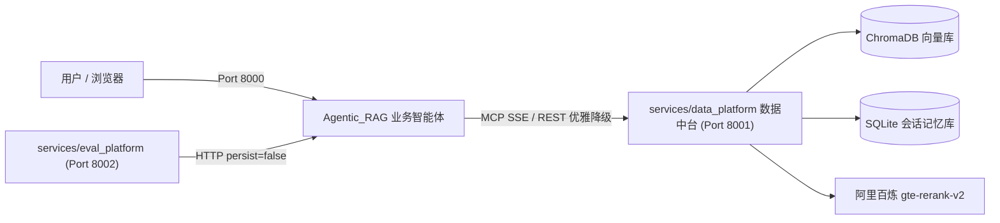

# 🚀 Agentic RAG 企业级微服务智能关联知识库与工业级量化评测系统

基于 **FastAPI 微服务集群 + MCP (SSE) + LangChain Tool-Calling + ChromaDB + Ollama + 阿里百炼（通义千问）+ uv** 构建的高性能企业级多跳智能检索推理中枢与 Ragas 工业级量化评测体系。

---

## 🌟 一、 微服务全景架构与核心机制

系统已升级解耦为三大独立协同微服务，并通过根目录总控入口 [app.py](file:///C:/Users/Administrator/.gemini/antigravity/worktrees/RAG_project/project_code_refactor/app.py) 实现一键并发启动、健康检查与日志聚合：

| 微服务 | 默认端口 | 定位与职责 | Web 入口 |
| :--- | :---: | :--- | :--- |
| **业务智能体 (Agent Core)** | `8000` | 纯业务多轮对话、ReAct 多跳工具调度、SSE 真流式打字机、模型热切换 | `http://127.0.0.1:8000/` |
| **数据中台 (Data Platform)** | `8001` | 文档解析/清洗/向量入库、双层漏斗检索、SQLite 多租户会话记忆、标准 **MCP Server (`/mcp/sse`)** | `http://127.0.0.1:8001/` |
| **评测中台 (Eval Platform)** | `8002` | 五阶段工业级评测流水线（自动命题、审题、远程并发作答、独立裁判打分、21 列 Excel 编译） | `http://127.0.0.1:8002/` |



### 🛡️ 核心模型分工体系
1. **出题专家 & 独立反思裁判**：锁定 **`qwen3.8-max-0902`**（阿里百炼顶级逻辑模型，负责深度命题与 Ragas 四维量化反思打分）；
2. **考生系统 & 默认问答主力**：默认 **`qwen3.8-flash`**（支持热切换至 `qwen3.8-max-0902` / `deepseek-v4-pro-0813` / `deepseek-v4-flash-0731`，向下兼容旧别名 `qwen3.7-plus`）；
3. **语义精排重排引擎**：阿里百炼云端 Cross-Attention 模型 **`gte-rerank-v2`**；
4. **向量嵌入初筛**：本地 Ollama **`bge-m3`**（1024 维 Dense 稠密向量）。

### 📐 双层漏斗过滤机制
- **第一层初筛（向量检索）**：ChromaDB 召回候选 Top-10，欧氏距离阈值截断 $\le 550.0$；
- **第二层精排（语义重排）**：百炼 `gte-rerank-v2` 深度精排 Top-3，相关度得分截断 $\ge 0.40$；
- **诚实拒答保护**：若无合格切片通过两层截断，触发【诚实拒答】，严禁幻觉编造。

---

## 📂 二、 目录结构与核心模块说明

```text
RAG_project/
├── app.py                              # 三大微服务一键并发启动与日志聚合总控入口
├── pyproject.toml / uv.lock            # uv 工程依赖声明与确定性锁文件
├── common/                             # 公共基础设施层
│   ├── logging_config.py               # 统一 JSONL/控制台日志与全链路 X-Trace-ID 透传
│   └── models.py                       # 统一模型配置中心与工厂 (三端单一事实源)
├── Agentic_RAG/                        # [Port 8000] 业务智能体微服务
│   ├── app.py                          # FastAPI 入口、健康自检与页面渲染
│   ├── agent.py                        # ReAct 智能体循环、真流式推流与预算耗尽合成
│   ├── mcp_client.py                   # 标准 MCP SSE 客户端 (支持事件循环安全隔离与自动降级)
│   ├── tools.py                        # @tool 工具箱 (list/search/read) 与 HTTP 降级适配器
│   ├── models.py / schemas.py          # 模型重导出与对话契约 (支持 persist 隔离评测流量)
│   └── routers/                        # chat.py (SSE 对话), session.py (无状态会话代理)
├── services/
│   ├── data_platform/                  # [Port 8001] 数据中台与 MCP Server
│   │   ├── app.py                      # REST API、文档管理、双层检索与会话持久化网关
│   │   ├── mcp_server.py               # Anthropic MCP 2.x Server (/mcp/sse)
│   │   ├── vector_store.py             # 文档解析清洗、分块与 ChromaDB 管理
│   │   ├── reranker.py                 # 双层阈值截断漏斗引擎
│   │   └── chat_history_db.py          # SQLite WAL 多租户会话与步骤轨迹持久化
│   └── eval_platform/                  # [Port 8002] 五阶段评测中台
│       ├── app.py                      # 五阶段流水线调度、SSE 推流与 21 列 Excel 导出
│       ├── dataset_generator.py        # 知识库自动命题与待审核题库导出
│       ├── benchmark_runner.py         # 并发评测运行器与 Excel 报表编译器
│       └── evaluator.py                # Ragas All-in-One 量化裁判引擎
└── tests/                              # 自动化单元测试与契约验证
```

---

## 🔑 三、 环境准备与快速启动

### 1. 配置环境变量与本地 Ollama
```powershell
$env:DASHSCOPE_API_KEY="sk-your-dashscope-api-key"
ollama pull bge-m3
```

### 2. 安装依赖 (uv)
```bash
uv sync
```

### 3. 一键启动三大微服务集群
```bash
# 在项目根目录执行（推荐）
uv run python app.py
```

如需单独启动某个微服务调试：
```bash
# 数据中台 (8001)
uv run uvicorn app:app --app-dir services/data_platform --host 0.0.0.0 --port 8001

# 评测中台 (8002)
uv run uvicorn app:app --app-dir services/eval_platform --host 0.0.0.0 --port 8002

# 业务智能体 (8000)
uv run uvicorn Agentic_RAG.app:app --host 0.0.0.0 --port 8000
```

---

## 🛠️ 四、 命令行批量评测与自动化验证

```bash
# 阶段一：从指南或文档生成待审核基准测试集
uv run python services/eval_platform/dataset_generator.py --mode from-guide

# 阶段三至五：CLI 批量并发评测并编译 21 列 Excel 报表
uv run python services/eval_platform/benchmark_runner.py --quick

# 运行离线单元测试与契约检查
python -m unittest discover -s tests -v
```
