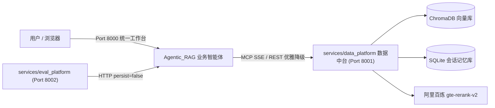

# 🚀 Agentic RAG 企业级微服务智能关联知识库与工业级量化评测系统

基于 **FastAPI 微服务集群 + MCP (SSE) + LangChain Tool-Calling + ChromaDB + Ollama + 阿里百炼（通义千问 / Kimi / GLM / DeepSeek）+ Vue 3 + Vite + Tailwind CSS + uv** 构建的高性能企业级多跳智能检索推理中枢与 Ragas 工业级量化评测体系。

---

## 🌟 一、 微服务全景架构与核心机制

系统已升级解耦为三大独立协同微服务，并通过根目录总控入口 [app.py](app.py) 实现一键并发启动、健康检查与日志聚合；同时在 `8000` 端口托管 **Vue 3 + Vite + Tailwind CSS 统一工作台**，整合智能问答、知识中台与评测中枢，并向下兼容各微服务独立页面：

| 微服务 | 默认端口 | 定位与职责 | Web 入口 |
| :--- | :---: | :--- | :--- |
| **业务智能体与统一工作台 (Agent Core)** | `8000` | Vue 3 统一 SPA（整合智能问答 `/`、知识中台 `/knowledge`、评测中枢 `/eval`）、ReAct 多跳工具调度、SSE 真流式输出、模型热切换 | `http://127.0.0.1:8000/` |
| **数据中台 (Data Platform)** | `8001` | 文档解析/清洗/向量入库、双层漏斗检索、SQLite 多租户会话记忆、标准 **MCP Server (`/mcp/sse`)** | `http://127.0.0.1:8001/` |
| **评测中台 (Eval Platform)** | `8002` | 五阶段工业级评测流水线（自动命题、增量补齐、并发作答、独立裁判打分、配额熔断保护、21 列 Excel 编译） | `http://127.0.0.1:8002/` |



### 🛡️ 核心模型分工体系（三模型异构隔离）
1. **出题专家 (Model A)**：默认 **`glm-5.2`**（高性价比长文命题专家，支持单文档/跨文档混合命题、增量补齐与断尾 JSON 自动抢救）；
2. **考生系统 & 默认问答主力 (Model B)**：当前默认 **`qwen3.6-flash-2026-04-16`**（本轮 84 题大规模盲测采用 **`qwen3.8-27b`**，支持热切换至 `qwen3.8-flash` / `qwen3.8-max-0902` / `kimi-k3` / `glm-5.2` / `deepseek-v4-pro-0813`，向下兼容历史模型别名自动兜底迁移）；
3. **独立反思裁判 (Model C)**：锁定 **`kimi-k3`**（阿里百炼深度反思模型，负责 Ragas 四维量化评分与归因诊断，与命题/作答模型严格异构分离）；
4. **语义精排重排引擎**：阿里百炼云端 Cross-Attention 模型 **`gte-rerank-v2`**；
5. **向量嵌入初筛**：本地 Ollama **`bge-m3`**（1024 维 Dense 稠密向量，多线程并发 `/api/embeddings` 吞吐加速）。

### 📐 双层漏斗过滤机制
- **第一层初筛（向量检索）**：ChromaDB 召回候选 Top-10，欧氏距离阈值截断 $\le 550.0$；
- **第二层精排（语义重排）**：百炼 `gte-rerank-v2` 深度精排 Top-3，相关度得分截断 $\ge 0.40$；
- **诚实拒答保护**：若无合格切片通过两层截断，触发【诚实拒答】，严禁幻觉编造。

---

## 📊 二、 工业级 Ragas 量化评测实测成绩

系统知识库已扩充至 **48 篇企业多域与公开权威长文档（547 切片）**（覆盖国家法律合规原文、TiDB / Kubernetes / FastAPI 官方中文文档及企业业务手册），并基于 **100 题全维度基准题库**开展双模型并发盲测。本轮实际执行 **84 题**（覆盖 **42 篇文档**，第 `#11` 题触发作答模型配额熔断保护并安全暂停，保留 **83 题有效样本**）：
- **出题专家 (Model A)**：`glm-5.2` | **考生系统 (Model B)**：`qwen3.8-27b`（8 并发） | **独立裁判 (Model C)**：`kimi-k3`（10 并发）
- **检索底座**：Ollama `bge-m3` + 阿里百炼 `gte-rerank-v2` 双层漏斗

### 1. 最新大规模压测成绩单（`2026-11-28 00:35:58`）

| 量化评估维度 | 实测得分 | 健康度评级 | 指标说明 |
| :--- | :---: | :---: | :--- |
| **🎯 RAG 三元组综合分 (Harmonic Mean)** | **`0.9213`** | **卓越 (EXCELLENT)** | 忠实度、相关性、精确度调和平均，木桶效应极严苛综合指标 |
| **🛡️ 事实忠实度 (Faithfulness)** | **`0.9690`** | **卓越 (EXCELLENT)** | 抗幻觉能力，原子声明严格由检索切片支撑 |
| **🎯 答案相关性 (Answer Relevance)** | **`0.9305`** | **卓越 (EXCELLENT)** | 直击提问关切与强格式指令遵循能力 |
| **🔍 上下文精确度 (Context Precision)** | **`0.8801`** | **卓越 (EXCELLENT)** | 双层漏斗过滤后的有效上下文排序信噪比 |
| **📚 上下文召回率 (Context Recall)** | **`0.9380`** | **卓越 (EXCELLENT)** | 黄金标准答案核心要点高质量召回覆盖 |
| **⚙️ 有效通过率 / 工程可靠性** | **`93.98%` 有效通过 (`78/83`)** | **生产级稳定** | 含 1 题配额熔断总通过率 `92.86%`、裁判故障率 `0.0%`、单题平均耗时 `4.89s`（总耗时 `410.91s`） |

### 2. 四大专项题型细粒度拆解（83 有效样本）

| 专项题型 | 有效 / 计划 | 通过数 (有效通过率) | RAG 三元组 | 事实忠实度 | 答案相关性 | 上下文精确度 | 上下文召回率 |
| :--- | :---: | :---: | :---: | :---: | :---: | :---: | :---: |
| **🔍 精度-高噪辨析题** | `24 / 24` | `23 (95.8%)` | `0.9604` | `0.9958` | `0.9642` | `0.9229` | `0.9417` |
| **📚 召回率-多跳聚合题** | `23 / 23` | `22 (95.7%)` | `0.9111` | `0.9470` | `0.9613` | `0.8435` | `0.9326` |
| **🛡️ 忠实度-边界拒答题** | `16 / 16` | `15 (93.8%)` | `0.9157` | `0.9375` | `0.8862` | `0.9344` | `0.9375` |
| **🎯 相关性-指令约束题** | `20 / 21` | `18 (90.0%)` | `0.8906` | `0.9875` | `0.8900` | `0.8275` | `0.9400` |

### 3. 工程调优四轮演进对比

| 优化阶段 | 测试规模 | 有效通过率 | RAG 三元组 | 事实忠实度 | 答案相关性 | 上下文精确度 | 上下文召回率 | 关键改进 |
| :--- | :---: | :---: | :---: | :---: | :---: | :---: | :---: | :--- |
| 基线版本 (`11-26 21:12`) | `20 题` | `70.0%` | `0.7923` | `0.8110` | `0.8710` | `0.7970` | `0.8565` | 微服务与 MCP 链路全量打通，0 故障 |
| 第一轮优化 (`11-26 22:19`) | `20 题` | `90.0%` | `0.9138` | `0.9775` | `0.9625` | `0.8380` | `1.0000` | 修复精读切片拆分去重与强格式指令优先级 |
| 第二轮定版 (`11-27 00:03`) | `20 题` | `90.0%` | `0.9158` | `0.9705` | `0.9655` | `0.8525` | `1.0000` | 优化检索优先策略，五项核心指标全部跨越 `0.85` 卓越线 |
| **本轮大规模压测 (`11-28 00:35`)** | **`48 文档 / 83 有效题`** | **`93.98%`** | **`0.9213`** | **`0.9690`** | **`0.9305`** | **`0.8801`** | **`0.9380`** | 知识库扩充至 48 篇长文档、三模型异构并发 + 向量尺度对齐与工具瘦身，耗时由 `18.47s/题` 降至 `4.89s/题`，Triad 升至 `0.9213` |

> **完整评测产物与逐题 Trace 报表**：
> - 21 列量化明细与 KPI 仪表盘 Excel：[基准评测集_带量化指标.xlsx](services/eval_platform/benchmarks/基准评测集_带量化指标.xlsx)（历史存档副本：[11.27.2.xlsx](测试集/测试结果/11.27.2.xlsx)）
> - 最新评测 JSON 快照：[最新评测报告.json](services/eval_platform/benchmarks/最新评测报告.json)
> - 100 题全量待审核题库：[待审核基准测试集.json](services/eval_platform/benchmarks/待审核基准测试集.json)

---

## 📂 三、 目录结构与核心模块说明

```text
RAG_project/
├── app.py                              # 三大微服务一键并发启动与日志聚合总控入口
├── pyproject.toml / uv.lock            # uv 工程依赖声明与确定性锁文件
├── common/                             # 公共基础设施层
│   ├── logging_config.py               # 统一 JSONL/控制台日志与全链路 X-Trace-ID 透传
│   └── models.py                       # 统一模型配置中心与工厂 (三端单一事实源)
├── frontend/                           # Vue 3 + Vite + Tailwind CSS 统一前端工作台
│   ├── src/                            # 问答/知识中台/评测中枢视图与 SSE/API 封装
│   └── dist/                           # 预构建静态产物（由 8000 端口托管）
├── Agentic_RAG/                        # [Port 8000] 业务智能体微服务
│   ├── app.py                          # FastAPI 入口、统一工作台托管、健康自检与旧版页面兼容
│   ├── agent.py                        # ReAct 智能体循环、真流式推流与预算耗尽合成
│   ├── mcp_client.py                   # 标准 MCP SSE 客户端 (支持事件循环安全隔离与自动降级)
│   ├── tools.py                        # @tool 工具箱 (list/search/read) 与 HTTP 降级适配器
│   ├── models.py / schemas.py          # 模型重导出与对话契约 (支持 persist 隔离评测流量)
│   └── routers/                        # chat.py (SSE 对话), session.py (无状态会话代理)
├── services/
│   ├── data_platform/                  # [Port 8001] 数据中台与 MCP Server
│   │   ├── app.py                      # REST API、文档管理、双层检索与会话持久化网关
│   │   ├── mcp_server.py               # Anthropic MCP 2.x Server (/mcp/sse)
│   │   ├── vector_store.py             # 文档解析清洗、分块与 ChromaDB 管理
│   │   ├── reranker.py                 # 双层阈值截断漏斗引擎
│   │   └── chat_history_db.py          # SQLite WAL 多租户会话与步骤轨迹持久化
│   └── eval_platform/                  # [Port 8002] 五阶段评测中台
│       ├── app.py                      # 五阶段流水线调度、SSE 推流与 21 列 Excel 导出
│       ├── dataset_generator.py        # 知识库自动命题、增量补齐与待审核题库导出
│       ├── benchmark_runner.py         # 并发评测运行器、配额熔断保护与 Excel 报表编译器
│       └── evaluator.py                # Ragas All-in-One 量化裁判引擎
├── scripts/                            # 运维与数据准备辅助脚本
│   ├── fetch_public_rag_docs.py        # 公开权威长文档（法律/TiDB/K8s/FastAPI）批量拉取脚本
│   └── probe_dashscope_rate_limit.py   # 百炼并发限流阶梯探测脚本
└── tests/                              # 自动化单元测试与契约验证
    ├── test_eval_pipeline.py           # 双模型并发评测、增量补齐与配额熔断回归测试
    └── test_refactor_verification.py   # 架构契约、去重、日志与回退单元测试
```

---

## 🔑 四、 环境准备与快速启动

### 1. 配置环境变量与本地 Ollama
```powershell
$env:DASHSCOPE_API_KEY="sk-your-dashscope-api-key"
ollama pull bge-m3
```

### 2. 安装依赖 (uv)
```bash
uv sync
```

### 3. 一键启动三大微服务集群
```bash
# 在项目根目录执行（推荐）
uv run python app.py
```

如需单独启动某个微服务调试：
```bash
# 数据中台 (8001)
uv run uvicorn app:app --app-dir services/data_platform --host 0.0.0.0 --port 8001

# 评测中台 (8002)
uv run uvicorn app:app --app-dir services/eval_platform --host 0.0.0.0 --port 8002

# 业务智能体 (8000)
uv run uvicorn Agentic_RAG.app:app --host 0.0.0.0 --port 8000
```

---

## 🛠️ 五、 命令行批量评测与自动化验证

```bash
# 阶段一：从指南或文档生成待审核基准测试集
uv run python services/eval_platform/dataset_generator.py --mode from-guide

# 阶段三至五：CLI 批量并发评测并编译 21 列 Excel 报表
uv run python services/eval_platform/benchmark_runner.py --quick

# 运行离线单元测试与契约检查
python -m unittest discover -s tests -v
```
