# 🚀 Agentic RAG 企业级智能关联知识库与工业级量化评测系统

基于 **FastAPI + LangChain Tool-Calling + ChromaDB + Ollama + 阿里百炼（通义千问）+ uv** 构建的高性能企业级多跳智能检索推理中枢与 Ragas 工业级量化评测体系。

---

## 🌟 一、 系统全景架构与核心机制

本系统旨在解决传统 RAG“检索噪音大、易产生幻觉、跨多文档难以多跳推理、缺乏严谨量化打分”的核心痛点，落地了工业级的**模型分工体系**与**双层漏斗过滤算法**：

```mermaid
flowchart TD
    subgraph 1. 知识库预处理与初筛
        DOCS[业务文档: MD / PDF / Word / TXT] --> VS[vector_store.py: 智能清洗与切分]
        VS --> EMB[models.py: Ollama bge-m3 1024维]
        EMB --> CHROMA[(ChromaDB: 向量索引持久化)]
    end

    subgraph 2. 问答推理与双层检索漏斗
        QUERY[用户提问 / 考生答卷] --> AGENT[agent.py: ReAct 智能体循环]
        AGENT --> S1[第一层初筛: ChromaDB Top-10 召回 / 距离 <= 550.0]
        S1 --> S2[第二层精排: 阿里百炼 gte-rerank-v2 Cross-Attention Top-3 / 得分 >= 0.40]
        S2 -->|无合格切片| REFUSE[触发诚实拒答机制: 严防幻觉胡编]
        S2 -->|提取黄金切片| LLM_ANS[models.py: qwen3.7-plus 考生作答模型]
        LLM_ANS --> SSE[SSE 打字机流式输出 / 步骤1-2-3卡片日志]
    end

    subgraph 3. 工业级五阶段评测流水线
        P1[阶段一: 命题专家 qwen3.8-max 靶向出题] --> P2[阶段二: 待审核测试集审题与导出]
        P2 --> P3[阶段三: 考生系统 qwen3.7-plus 批量作答与快照持久化]
        P3 --> P4[阶段四: 裁判模型 qwen3.8-max 深度原子反思与 Ragas 量化打分]
        P4 --> P5[阶段五: 全维看板 + 21列带量化指标 Excel 报表编译同步]
    end
```



### 🛡️ 核心模型分工体系（严禁混淆）
1. **出题专家 & 独立反思裁判**：严格且仅使用 **`qwen3.8-max`**（阿里百炼旗舰顶级逻辑模型，具备超强长文本推理与反思纠错能力）；
2. **考生系统客观作答**：严格使用 **`qwen3.7-plus`**（阿里百炼主力问答模型，兼顾响应速度与上下文拟合）；
3. **语义精排重排引擎**：统一接入阿里百炼官方云端 Cross-Attention 模型 **`gte-rerank-v2`**（双层阈值过滤，免下载本地大权重，零显存占用）；
4. **向量嵌入初筛**：本地 Ollama **`bge-m3`**（1024 维 Dense 稠密向量，覆盖多语言与长切片）。

### 📐 双层漏斗过滤机制
- **第一层初筛（向量检索）**：ChromaDB 召回候选 Top-10，欧氏距离阈值截断 $\le 550.0$（滤除无关噪音，超纲问题直接截断为 0 条）；
- **第二层精排（语义重排）**：百炼 `gte-rerank-v2` 深度精排 Top-3，相关度得分截断 $\ge 0.40$（只将真正的黄金事实送入模型上下文）；
- **诚实拒答保护**：过滤后若无合格切片，系统坚决触发【诚实拒答】，严禁胡编乱造。

---

## 📂 二、 全景文件资产架构与职能字典清单

系统全面遵循“高内聚、低耦合、动静分离”的企业微架构设计，各目录与文件分工如下：

```
E:\RAG_project\
├── pyproject.toml              # 项目包依赖声明与 Python 版本契约 (uv 规范)
├── uv.lock                     # 确定性版本锁文件 (锁定所有直接/间接依赖的哈希)
├── README.md                   # 系统架构、全文件字典与运行指令总说明书
│
├── Agentic_RAG/                # 核心后端工程主目录
│   ├── app.py                  # Web 服务总装配入口 (FastAPI 初始化、CORS、生命周期与静态挂载)
│   ├── models.py               # 🌟 全系统统一模型中枢与网关工厂 (LLM、Embedding、Reranker 统筹)
│   ├── schemas.py              # 🌟 Pydantic 数据契约层 (统一声明全系统 HTTP 请求/响应模型)
│   ├── agent.py                # 智能体中枢 (ReAct 循环、多跳工具调用、检索漏斗调度、流式推流)
│   ├── reranker.py             # 语义重排引擎 (阿里百炼 gte-rerank-v2 跨注意力打分与双层过滤漏斗)
│   ├── vector_store.py         # 向量知识库中枢 (文档解析切分、bge-m3 入库与 ChromaDB 管理)
│   ├── evaluator.py            # Ragas 工业级量化评估中枢 (qwen3.8-max 忠实度/相关度原子反思打分)
│   ├── benchmark_runner.py     # 评测流水线编译引擎 (生成 21 列题目明细与 Sheet 2 KPI 仪表盘报表)
│   ├── dataset_generator.py    # 黄金测试集派生引擎 (qwen3.8-max 深入知识库真实文档扫描派生考题)
│   ├── chat_history_db.py      # 对话历史持久化操作类 (SQLite 增删查改、会话生命周期管理)
│   ├── chat_history.db         # SQLite 数据库物理实体 (真实持久化用户多轮会话记录)
│   ├── requirements.txt        # 经典 Python 核心依赖清单 (供传统 pip 部署参考)
│   │
│   ├── routers/                # 🌟 APIRouter 子路由分层解耦包
│   │   ├── __init__.py         # 子路由包初始化
│   │   ├── chat.py             # 智能问答子路由 (/api/chat: SSE 流式打字机与步骤 1/2/3 卡片日志)
│   │   ├── knowledge.py        # 知识库子路由 (/api/upload, /documents: 上传预检、切片与物理删除)
│   │   ├── session.py          # 会话管理子路由 (/api/sessions: 多会话列表、历史详情与删除)
│   │   └── benchmark.py        # 五阶段评测流水线子路由 (/api/benchmark/...: 出题/作答/裁判/同步写盘)
│   │
│   ├── templates/              # 🌟 前端纯净 HTML 语义骨架层 (已彻底剥离内联 CSS 与 JS)
│   │   ├── index.html          # 主问答交互控制台页面 (纯骨架: 侧边栏、对话流、切片预览模态窗)
│   │   └── benchmark.html      # 企业级评测中枢工作台页面 (纯骨架: 五阶段 Stepper、Trace 模态窗)
│   │
│   ├── static/                 # 🌟 前端独立外置静态资产层 (支持浏览器原生 304 缓存加速)
│   │   ├── css/
│   │   │   ├── index.css       # 主问答界面样式表 (玻璃拟态、自适应布局、打字机光标动画)
│   │   │   └── benchmark.css   # 评测工作台样式表 (发光 KPI 仪表盘、题型状态徽章、Trace 对比视窗)
│   │   └── js/
│   │       ├── index.js        # 主问答界面交互逻辑 (SSE 流式解析、多会话切换、拖拽上传)
│   │       └── benchmark.js    # 评测工作台交互逻辑 (五阶段切换、双轨自愈、裁判执行、即时同步写盘)
│   │
│   ├── benchmarks/             # 评测体系持久化产物目录
│   │   ├── 待审核基准测试集.xlsx # 命题专家 (qwen3.8-max) 派生出的待审黄金考题库 (Excel 格式)
│   │   ├── 待审核基准测试集.json # 待审黄金考题库镜像 (JSON 格式)
│   │   ├── 最新作答记录.json     # 考生系统 (qwen3.7-plus) 批量检索作答快照凭据 (断点防丢)
│   │   ├── 最新评测报告.json     # 裁判模型 (qwen3.8-max) 深度反思打分汇总与 KPI 看板快照
│   │   └── 基准评测集_带量化指标.xlsx # 包含 21 列综合指标明细与 Sheet 2 仪表盘的权威 Excel 报表
│   │
│   ├── chroma_db/              # ChromaDB 本地向量集合物理存储目录
│   └── uploads/                # 知识库已入库真实业务文档暂存目录
│
├── 测试集/                     # 外部原始基准文档参考备份目录
└── 知识md/                     # 业务知识库长篇 Markdown 资料目录
```

---

### 📋 核心文件业务职能对照表

| 核心文件 | 所属分层 | 业务定位与核心职能 |
| :--- | :--- | :--- |
| **`app.py`** | Web 接入层 | **服务总入口**：集成 FastAPI、配置 CORS 跨域、挂载静态资源 `/static`、挂载 4 大子路由、提供 `/` 与 `/benchmark` 页面渲染。 |
| **`models.py`** | 统一模型网关 | **模型配置中心与工厂**：统一收口 `get_llm()`、`get_judge_llm()` (锁定 `qwen3.8-max`)、`get_answer_llm()` (锁定 `qwen3.7-plus`)、`get_embeddings()` (本地 `bge-m3`) 与 `get_reranker()` (`gte-rerank-v2`)，支持无感多模型热切换。 |
| **`schemas.py`** | 数据契约层 | **请求/响应规范**：声明 `ChatRequest`、`BenchmarkRunAnswersRequest`、`BenchmarkRunJudgeRequest`、`SyncExportRequest` 等 Pydantic 数据规范，彻底杜绝循环依赖。 |
| **`agent.py`** | 智能体中枢 | **多跳推理与调度**：实现 LangChain Tool-Calling 智能体、ReAct 思考循环、两阶段漏斗消费、诚实拒答判定及卡片式三步日志输出。 |
| **`reranker.py`** | 算法精排层 | **Cross-Attention 深度重排**：直连阿里百炼云端 `gte-rerank-v2`，计算 Query 与上下文切片的交叉注意力得分，实现得分 $\ge 0.40$ 的硬性截断。 |
| **`vector_store.py`** | 知识库存储层 | **文档切分与向量检索**：支持 PDF/Word/PPT/TXT/MD 多格式解析与图表预检，按语义切块并通过本地 Ollama `bge-m3` 执行欧氏距离 $\le 550.0$ 向量初筛。 |
| **`evaluator.py`** | 量化评测裁判 | **Ragas 工业打分引擎**：驱动 `qwen3.8-max` 针对四大题型进行忠实度（去幻觉）、答案相关度、上下文精度与召回率的深度反思打分与处方诊断。 |
| **`benchmark_runner.py`** | 报表生成引擎 | **21 列 Excel 编译**：将评测结果编译为具备专业配色与样式的标准 Excel 报表，包含 Sheet 1（21 列明细）与 Sheet 2（全维 KPI 看板）。 |
| **`dataset_generator.py`** | 考题派生引擎 | **黄金测试集生成**：让 `qwen3.8-max` 靶向扫描入库文档，自动构建涵盖客观事实、跨文档多跳、参数对比与超纲题型的考题矩阵。 |
| **`chat_history_db.py`** | 历史持久化层 | **会话管理**：基于 SQLite 实现多会话隔离、会话重命名、历史上下文拉取与物理清理。 |

---

## 🔑 三、 环境变量与前置依赖准备

### 1. 配置阿里百炼 API Key

系统调用百炼旗舰模型及 `gte-rerank-v2` 云端重排引擎，需注入环境变量：

#### Windows PowerShell：
```powershell
$env:DASHSCOPE_API_KEY="sk-your-dashscope-api-key"
```

#### Windows CMD：
```cmd
set DASHSCOPE_API_KEY=sk-your-dashscope-api-key
```

#### Linux / macOS：
```bash
export DASHSCOPE_API_KEY="sk-your-dashscope-api-key"
```

> **提示**：建议在 Windows 系统高级设置环境变量中永久添加 `DASHSCOPE_API_KEY`，无需重复配置。

---

### 2. 启动本地 Ollama 并拉取 `bge-m3` 模型

初筛向量检索基于本地运行的 Ollama `bge-m3`：

```bash
# 1. 验证 Ollama 服务状态
ollama --version

# 2. 拉取 1024 维 Dense 稠密向量模型
ollama pull bge-m3

# 3. 验证本地模型清单
ollama list
```

---

## ⚡ 四、 快速环境安装与同步 (基于 uv)

本项目使用现代高性能包管理工具 `uv`，提供基于锁文件（`uv.lock`）的一键秒级环境还原：

```bash
# 自动按 pyproject.toml 检查并秒级还原全部虚拟环境依赖
uv sync
```

---

## 🌐 五、 启动 Web 核心服务

### 方式 1：uv 免激活直接启动（推荐，秒级直启）
```bash
uv run python Agentic_RAG/app.py
```

### 方式 2：经典虚拟环境激活后启动（传统模式）
```bash
# Windows PowerShell
.venv\Scripts\Activate.ps1
python Agentic_RAG/app.py

# Windows CMD
.venv\Scripts\activate.bat
python Agentic_RAG/app.py

# Linux / macOS
source .venv/bin/activate
python Agentic_RAG/app.py
```

### 方式 3：自定义端口启动（例如 8000 端口）
```powershell
$env:PORT="8000"
uv run python Agentic_RAG/app.py
```

### 方式 4：使用 Uvicorn 原生启动
```bash
uv run uvicorn app:app --app-dir Agentic_RAG --host 0.0.0.0 --port 5000
```

---

## 🖥️ 六、 系统服务入口一览

服务启动成功后，浏览器访问以下地址：

| 功能入口 | 访问地址 | 说明 |
| :--- | :--- | :--- |
| **智能问答控制台** | `http://127.0.0.1:5000/` | 企业级对话界面，支持流式打字机、模型热切换、多轮历史追溯、文档上传与切片可视化检查 |
| **五阶段评测流水线中枢** | `http://127.0.0.1:5000/benchmark` | 企业级流水线评测工作台（出题 -> 审题标注 -> 考生作答 -> 裁判打分 -> 21列报表与双轨自愈） |
| **OpenAPI 交互文档** | `http://127.0.0.1:5000/docs` | 交互式 Swagger API 调试台，支持测试系统全量 23 个 HTTP 端点 |
| **Redoc API 规范** | `http://127.0.0.1:5000/redoc` | 工业级接口技术规范在线阅读说明书 |

---

## 🛠️ 七、 独立命令行工具链（CLI 批处理运行）

系统支持不依赖 Web 界面，直接在终端中自动化运行测试集派生与评测报表生成：

### 1. 阶段一：知识库黄金测试集自动化出题 (`dataset_generator.py`)

```bash
# 模式 A：从内置精选指南直接快速装载生成待审核基准测试集
uv run python Agentic_RAG/dataset_generator.py --mode from-guide

# 模式 B：调用 qwen3.8-max 深入知识库真实文档扫描派生考题
uv run python Agentic_RAG/dataset_generator.py --mode generate --model-a qwen3.8-max --workers 2

# 指定自定义输出 Excel 路径
uv run python Agentic_RAG/dataset_generator.py --output Agentic_RAG/benchmarks/待审核基准测试集.xlsx
```

---

### 2. 阶段三至五：全自动批量作答、独立裁判打分与 21 列 Excel 编译 (`benchmark_runner.py`)

```bash
# 1. 快速抽样评测（评测前 3 道题目）
uv run python Agentic_RAG/benchmark_runner.py --limit 3

# 2. 标准批量评测（指定模型：qwen3.7-plus 作答 + qwen3.8-max 裁判，运行前 5 道题）
uv run python Agentic_RAG/benchmark_runner.py --limit 5 --model-b qwen3.7-plus --model-c qwen3.8-max

# 3. 全量运行整套基准题库
uv run python Agentic_RAG/benchmark_runner.py --limit 0

# 4. 指定自定义题库与自定义报告输出路径
uv run python Agentic_RAG/benchmark_runner.py --excel Agentic_RAG/benchmarks/待审核基准测试集.xlsx --output Agentic_RAG/benchmarks/基准评测集_带量化指标.xlsx
```

> **执行后产物**：
> - `Agentic_RAG/benchmarks/基准评测集_带量化指标.xlsx`（包含 Sheet 1 题目明细 21 列与 Sheet 2 仪表盘总览）
> - `Agentic_RAG/benchmarks/最新评测报告.json`
> - `Agentic_RAG/benchmarks/最新作答记录.json`

---

## 🔍 八、 运维与常见排错急救指令

### 1. Windows 下 5000 端口被占用的释放指令

如果遇到 `[Errno 10048] address already in use` 端口冲突错误，直接执行以下一键强杀命令：

```powershell
# 自动嗅探并一键强杀占用 5000 端口的所有残留进程
Get-NetTCPConnection -LocalPort 5000 -ErrorAction SilentlyContinue | ForEach-Object { Stop-Process -Id $_.OwningProcess -Force }
```

### 2. 快速排查后端健康状态（单行测试）

在不打开浏览器的前提下，自检本地 API、Ollama 和 ChromaDB 状态：

```powershell
uv run python -c "import sys; sys.path.insert(0, 'Agentic_RAG'); from fastapi.testclient import TestClient; import app; c = TestClient(app.app); print(c.get('/api/status').json())"
```

### 3. 日常依赖维护指令

```bash
# 新增依赖并自动写入 pyproject.toml 与锁文件
uv add <package-name>

# 移除指定依赖
uv remove <package-name>

# 严格将本地环境与锁文件对齐
uv sync

# 打印项目完整依赖层级树
uv tree
```
