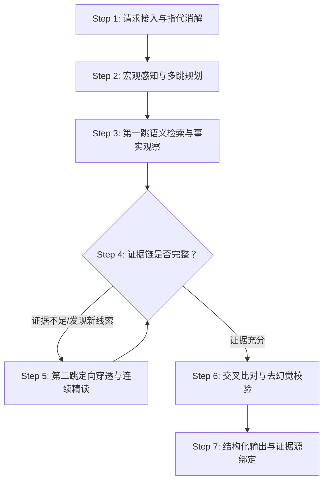
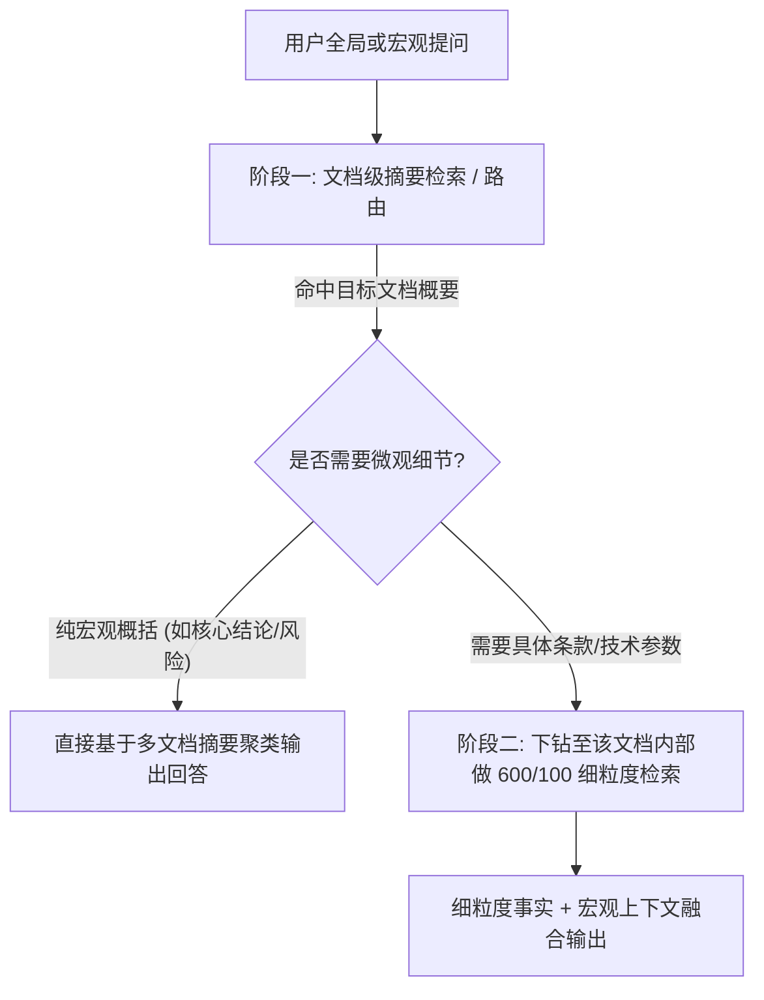

# Agentic RAG 企业智能知识库系统：召回、重排与智能体执行全流程深度解析

---

## 目录
1. [传统 RAG 与 Agentic RAG 的本质区别](#1-传统-rag-与-agentic-rag-的本质区别)
2. [召回（Retrieval）与重排（Reranking）的核心原理与本项目实现](#2-召回retrieval与重排reranking的核心原理与本项目实现)
   - [2.1 什么是召回（Retrieval）？](#21-什么是召回retrieval)
   - [2.2 本项目的初阶召回：BGE-M3 + ChromaDB](#22-本项目的初阶召回bge-m3--chromadb)
   - [2.3 什么是重排（Reranking）？](#23-什么是重排reranking)
   - [2.4 本项目的“认知级动态重排”机制](#24-本项目的认知级动态重排机制)
   - [2.5 业界常见重排方案扩展（Cross-Encoder / BGE-Reranker）](#25-业界常见重排方案扩展cross-encoder--bge-reranker)
3. [Agent 执行问答的每一步端到端全流程拆解](#3-agent-执行问答的每一步端到端全流程拆解)
   - [Step 1：请求接入与多轮对话指代消解（Coreference Resolution）](#step-1请求接入与多轮对话指代消解coreference-resolution)
   - [Step 2：宏观感知与检索规划（Macro Awareness）](#step-2宏观感知与检索规划macro-awareness)
   - [Step 3：第一跳语义检索与事实观察（First-Hop Retrieval）](#step-3第一跳语义检索与事实观察first-hop-retrieval)
   - [Step 4：证据缺口分析与多跳触发决策（Gap Analysis）](#step-4证据缺口分析与多跳触发决策gap-analysis)
   - [Step 5：定向穿透与连续上下文精读（Second-Hop & Deep Read）](#step-5定向穿透与连续上下文精读second-hop--deep-read)
   - [Step 6：冲突比对、多源融合与去幻觉校验（Synthesis & Fact-Checking）](#step-6冲突比对多源融合与去幻觉校验synthesis--fact-checking)
   - [Step 7：格式化结构输出与证据链溯源绑定（Structured Response）](#step-7格式化结构输出与证据链溯源绑定structured-response)
4. [核心相关技术与知识点全景剖析](#4-核心相关技术与知识点全景剖析)
   - [4.1 双塔模型（Bi-Encoder）vs 交叉编码器（Cross-Encoder）](#41-双塔模型bi-encoder-vs-交叉编码器cross-encoder)
   - [4.2 向量嵌入模型（Embedding）与 BGE-M3 特性](#42-向量嵌入模型embedding与-bge-m3-特性)
   - [4.3 向量检索距离度量（Cosine / L2 / IP）与 HNSW 索引](#43-向量检索距离度量cosine--l2--ip与-hnsw-索引)
   - [4.4 ReAct 范式（Reasoning + Acting）底层机制](#44-react-范式reasoning--acting底层机制)
   - [4.5 大模型工具调用（Tool Calling / Function Calling）机制](#45-大模型工具调用tool-calling--function-calling机制)
   - [4.6 语义切片分块策略（Chunking Strategy）](#46-语义切片分块策略chunking-strategy)
   - [4.7 内容哈希防重机制与知识库生命周期更新（Content Hash Deduplication）](#47-内容哈希防重机制与知识库生命周期更新content-hash-deduplication)
   - [4.8 摘要索引（Summary Index）与分层检索机制（Hierarchical Retrieval）](#48-摘要索引summary-index与分层检索机制hierarchical-retrieval)
   - [4.9 动态多模型热切换（Runtime Model Hot-Swapping）架构](#49-动态多模型热切换runtime-model-hot-swapping架构)
   - [4.10 现代 Python 工程化管理：基于 uv 的确定性构建](#410-现代-python-工程化管理基于-uv-的确定性构建)
5. [系统架构总览图与时序图](#5-系统架构总览图与时序图)

---

## 1. 传统 RAG 与 Agentic RAG 的本质区别

传统朴素 RAG（Naive RAG）是一个**单向静态流水线**：


### 传统 RAG 的致命痛点：
1. **“一锤子买卖”无法处理复杂多跳问题**：若回答问题需要先查《系统架构书》得知某依赖组件名，再查《接口手册》找配置参数，传统 RAG 单次检索极易漏掉第二份文档；
2. **检索词僵化**：用户提问常带口语化、代词（“它”、“这个系统”），直接拿模糊输入做向量匹配，召回精度急剧下降；
3. **缺乏反思能力**：若检索到的片段不包含答案，传统 RAG 无法察觉，往往直接基于无关片段胡编乱造（产生幻觉）；
4. **文档割裂与碎片化**：无法跨越长文档把握全局结论，遇到“总结这份报告的核心结论”类宏观问题完全失效。

### Agentic RAG 的解法：
将 LLM 升级为一个**具有自主规划、工具调用、自我反思、多步验证能力的智能体（Agent）**：
- 能够**自主改写与拆解检索词**；
- 能够**自主决定查全库还是查单篇**；
- 发现证据不足时，**自动发起第二跳、第三跳迭代追查**；
- 结合**摘要索引**与**连续上下文精读**，兼顾微观细节与宏观全貌；
- 最终汇聚所有证据链，并标注来源出处。

---

## 2. 召回（Retrieval）与重排（Reranking）的核心原理与本项目实现

### 2.1 什么是召回（Retrieval）？
**召回**是在海量候选集（成千上万个文档切片）中，以**极高速度**粗筛出与查询最相关的几十个或几个候选片段的过程。

- **核心目标**：保证**查全率（Recall）**，宁可少量多带，不能漏掉真正有用的关键切片。
- **主流方式**：
  - **稠密向量召回（Dense Retrieval）**：通过 Embedding 模型将文本映射为连续向量，计算余弦相似度或内积距离；
  - **稀疏关键词召回（Sparse Retrieval）**：如 BM25、TF-IDF，基于词频精准命中专有名词；
  - **混合召回（Hybrid Retrieval）**：向量检索 + BM25 融合（RRF / 权重融合）。

### 2.2 本项目的初阶召回：BGE-M3 + ChromaDB
在本项目中，召回由 `vector_store.py` 中的 `query_similar_chunks` 完成：

1. **向量化编码**：调用部署在本地 Ollama 的 `BAAI/bge-m3` 模型，将用户的 Query 编码为 1024 维的高维浮点向量；
2. **向量空间相似度检索**：
   ```python
   # ChromaDB 向量检索
   results = self.collection.query(
       query_embeddings=[query_vector],
       n_results=top_k,
       where=where_filter,  # 支持针对指定 doc_name 元数据精确过滤
       include=["documents", "metadatas", "distances"]
   )
   ```
3. **元数据过滤与路由**：支持基于元数据（`doc_name`）的精准下钻过滤。当 Agent 明确已知目标在某篇文档时，自动收窄检索范围，彻底消除其他文档的噪声干扰。

### 2.3 什么是重排（Reranking）？
**重排**是在召回出的候选片段（例如 Top-20）中，使用计算复杂度更高、语义理解更细腻的模型，对片段与问题的匹配度进行**精细打分与重新排序**，挑选出最核心的 Top-N（如 Top-3）输入大模型。

- **为什么需要重排？**
  - 双塔向量模型（Bi-Encoder）在编码 Query 和 Document 时是彼此独立的，缺乏字与字之间的深度交叉注意力（Cross-Attention）；
  - 向量相似度高往往只代表“话题接近”，并不代表该段落真的“正面回答了问题”；
  - 重排器能识别出“字面相似但逻辑不符”与“表达完全不同但逻辑强相关”的深层关系。

### 2.4 本项目的“认知级动态重排”机制
在传统流水线中，重排通常由一个独立的轻量模型（如 `bge-reranker-large`）计算标量分数。而在本项目中，采用了更为先进的 **Agentic 认知级动态重排（Cognitive / Generative Reranking）**：

1. **Agent 自主审查过滤（Observation Review）**：
   - 向量库召回切片后，Agent（如 DeepSeek-V3 / Qwen / GLM-4）以完整的思考步骤对切片进行理解与逻辑校验；
   - 若发现召回片段内容零散、未触及核心，Agent 会**自主在思维链中废弃该片段**，绝不盲目引用；
2. **连续上下文补充阅读（Read Continuous Chunks）**：
   - 当向量召回的单一切片（Chunk）跨度有限导致逻辑断层时，Agent 会主动调用 `read_specific_document(doc_name, max_chunks=6)` 工具，按照 `chunk_index` 升序获取该文档连续的上下文段落，实现了从“点状召回”到“篇章级连贯理解”的升级。

### 2.5 业界常见重排方案扩展（Cross-Encoder / BGE-Reranker）
除了 Agent 认知级重排，业界主流方案通常在向量召回后串联一个专门的 Cross-Encoder 模型（如 `BAAI/bge-reranker-large`）：
- 输入格式：`[CLS] Query [SEP] Document [SEP]`；
- 算力特性：计算代价较大，但对细粒度语义相关性的判定极其敏锐，通常处理 Top-20 到 Top-50 的切片输入。

---

## 3. Agent 执行问答的每一步端到端全流程拆解

系统处理用户复杂问题的完整认知轨迹分为以下 7 个严密阶段：



### Step 1：请求接入与多轮对话指代消解（Coreference Resolution）
- **现象**：用户在多轮对话中常使用代词或省略主语，例如：“*它的最大连接数是多少？*”、“*如果改成分布式怎么配？*”；
- **机制**：Agent 接收当前 Query 与近期历史上下文，自主推断“它”指代上一轮对话中的具体业务组件，将内部检索 Query 改写为显式、无歧义的完整检索词。

### Step 2：宏观感知与检索规划（Macro Awareness）
- Agent 先行调用 `get_document_outline()` 或检索文档摘要，盘点知识库中当前存在哪些已收录文档；
- 自主推断解决当前问题需要涉及哪些实体，制定“单篇聚焦”还是“跨篇联动”的检索计划。

### Step 3：第一跳语义检索与事实观察（First-Hop Retrieval）
- Agent 输出带有具体语义参数的 Tool Call 决策，触发 `search_knowledge_base(query, top_k=5)`；
- 向量引擎完成计算后，将切片文本、元数据（所属文档、切片编号）打包为观察结果（Observation）注入上下文。

### Step 4：证据缺口分析与多跳触发决策（Gap Analysis）
- Agent 深度审视检索回来的内容：
  * **情况 A（发现新交叉引用）**：第一篇文档写着“*系统参数详见《基础配置规范.docx》第4章*”，Agent 识别出线索，判定必须发起第二跳；
  * **情况 B（信息缺失）**：检索内容只解释了原理，未包含具体配置值，Agent 识别出事实缺口。

### Step 5：定向穿透与连续上下文精读（Second-Hop & Deep Read）
- **定向下钻**：调用带 `doc_name="基础配置规范.docx"` 的精确下钻检索；
- **连续精读**：当遇到复杂表格或跨段落长描述时，调用 `read_specific_document` 按物理顺序读取连续的 3~6 个切片，彻底消除切片边缘割裂。

### Step 6：冲突比对、多源融合与去幻觉校验（Synthesis & Fact-Checking）
- 对比多份文档中关于同一实体的表述，辨别文档版本差异或条件约束（例如：“*在 Linux 环境下为 A，在 Windows 环境下为 B*”）；
- 严格遵循**无依据不推断**原则，若最终检索结果未提及某些事实，明确向用户告知未知，坚决杜绝大模型臆造。

### Step 7：格式化结构输出与证据链溯源绑定（Structured Response）
- 输出清晰易懂的 Markdown 回答；
- 在答案末尾自动列出可追溯的**证据链出处**（包含具体文档名、切片编号以及摘录的原句关键佐证），供用户自查核实。

---

## 4. 核心相关技术与知识点全景剖析

### 4.1 双塔模型（Bi-Encoder）vs 交叉编码器（Cross-Encoder）

| 维度 | 双塔模型 (Bi-Encoder，如 BGE-M3) | 交叉编码器 (Cross-Encoder，如 BGE-Reranker) |
| :--- | :--- | :--- |
| **网络结构** | Query 和 Document 分别输入两个独立的编码网络 | Query 和 Document 拼接为一句整体输入 Transformer |
| **交互深度** | 仅在最终层计算向量点积/余弦相似度，无词间交叉注意力 | 全层每一层词与词之间均发生 Full Self-Attention |
| **计算速度** | 文档向量可提前离线存入数据库，检索速度达毫秒级 | 必须在线实时两两计算，算力开销巨大 |
| **语义敏锐度** | 擅长广义主题匹配，对细微逻辑关系不敏感 | 对句法对立、否定词、修饰语极度敏感，打分极准 |
| **在系统中的定位**| 负责**第一阶段快速粗筛（召回）** | 负责**第二阶段精准甄别（重排）** |

---

### 4.2 向量嵌入模型（Embedding）与 BGE-M3 特性
本项目选用北京智源研究院开源的 **`BAAI/bge-m3`**，其具备三大革命性特性：
1. **Multi-Linguality（多语言强泛化）**：原生支持 100+ 种世界语言，中英文混合技术文档表现优异；
2. **Multi-Functionality（混合多粒度表征）**：
   - 稠密检索（Dense Retrieval）：提取 1024 维高维语义表征；
   - 稀疏检索（Sparse Retrieval）：输出词级别权重，天然兼具 BM25 般的专有名词精确匹配能力；
   - 多向量检索（ColBERT-style Multi-vector）：支持 Token 级别交互；
3. **Multi-Granularity（长文本支持）**：支持最大 8192 的上下文输入，告别传统 BERT 模型 512 字符的长度限制。

---

### 4.3 向量检索距离度量与 HNSW 索引
在 ChromaDB 中，高维向量检索依赖高效的相似度算法：
- **距离度量**：
  - **余弦距离（Cosine Distance）**：$1 - \frac{A \cdot B}{\|A\|\|B\|}$，只衡量方向差异，不受文本长度引起的向量模长干扰，为本项目默认度量方式；
  - **L2 欧氏距离**：衡量向量在几何空间中的直线距离；
  - **内积距离（Inner Product）**：向量已归一化时等价于余弦相似度。
- **底层索引算法（HNSW: Hierarchical Navigable Small World）**：
  - 基于跳表思想的多层图索引结构；
  - 上层图稀疏负责长距离“高速跳转”，底层图密集负责“精确定位”；
  - 将海量高维向量检索复杂度从线性的 $O(N)$ 降至对数级的 $O(\log N)$。

---

### 4.4 ReAct 范式（Reasoning + Acting）底层机制
智能体核心遵循 **ReAct 认知循环**：
$$\text{Thought（思考分析）} \longrightarrow \text{Action（决定调用工具）} \longrightarrow \text{Observation（观察工具返回）} \longrightarrow \text{Thought...}$$

1. **Thought**：Agent 阐明自己的意图、当前掌握了什么事实、还需要查什么；
2. **Action**：输出标准的 JSON Schema 工具调用入参；
3. **Observation**：执行层返回真实世界数据；
4. **Final Answer**：当思考得出“证据充分”的结论时，终止循环，输出解答。

---

### 4.5 大模型工具调用（Tool Calling）机制
传统文本匹配正则解析已淘汰，本项目采用原生的结构化 Function Calling：
1. **工具声明注册**：在 Python 端使用 `@tool` 装饰器声明函数名称、参数类型、详细 docstring 描述；
2. **Schema 注入**：LangChain 自动提取并转换为符合 OpenAI 规范的 JSON Schema 随请求发给大模型；
3. **大模型结构化响应**：大模型生成特定的 `tool_calls` 结构；
4. **本地安全拦截与路由**：Python 拦截 `tool_calls`，安全执行底层逻辑并将 `ToolMessage` 结果回传大模型。

---

### 4.6 语义切片分块策略（Chunking Strategy）
文本切片直接决定检索质量的上限：
- **切片过大（> 2000 字）**：向量表达过于泛化，相似度被稀释；
- **切片过小（< 100 字）**：主谓宾缺失，语义严重碎片化；
- **本项目生产级参数设计**：
  - **`chunk_size = 600`**：保持在 400~800 字符内，刚好是一个完整自然段或一个功能定义的跨度；
  - **`chunk_overlap = 100`**：保留 100 字符重叠滑动窗口，**确保跨句实体、指代不会在边缘被切断**；
  - **递归标点感知切分**：`["\n\n", "\n", "。", "！", "？", "；", " ", ""]`，绝不在句子中间打断。

---

### 4.7 内容哈希防重机制与知识库生命周期更新
在生产环境中，知识库面临“同内容不同名（副本泛滥）”与“同名文档更新（版本冲突）”的问题。本项目在 `vector_store.py` 中实现了基于 **SHA-256 内容哈希** 的查重过滤网：

| 业务场景 | 判定条件 | 触发动作 |
| :--- | :--- | :--- |
| **场景 A：同内容不同文件名（副本上传）** | `content_hash` 一致，但 `doc_name` 不同 | **立即拦截并跳过入库**：不计算 Embedding，不写向量库，杜绝知识库冗余膨胀。 |
| **场景 B：同名相同文件重复上传** | `content_hash` 一致，且 `doc_name` 相同 | **复用已有索引**：无需重新切片与向量化，节约算力与响应耗时。 |
| **场景 C：同名文件内容变更（文档更新）** | `doc_name` 相同，但 `content_hash` 不一致 | **版本覆盖写入**：自动调用底层彻底擦除旧切片及向量，再写入新版切片。 |

---

### 4.8 摘要索引（Summary Index）与分层检索机制（Hierarchical Retrieval）

针对传统 RAG 无法处理“全局性、宏观概括总结”问题的痛点，系统架构融合了**摘要索引与两阶段分层检索**思想：



1. **宏观总结支持**：预先提取每篇文档的高信息密度摘要，用户问及“总结这篇规范的主旨”时，无需拼接碎片，直接基于摘要给出高水准全局解答；
2. **海量文档路由（Document Routing）**：在拥有成百上千份制度或规范的大型知识库中，先搜摘要锁定具体目标文档，再进文档内部细搜，彻底解决海量切片互相干扰导致搜偏的痛点。

---

### 4.9 动态多模型热切换（Runtime Model Hot-Swapping）架构

为了摆脱对单一大模型供应商的依赖，系统在 `models.py` 与 `app.py` 实现了**动态模型工厂与热切换总线**：

1. **统一模型抽象协议**：兼容所有支持 OpenAI API 协议的标准大模型接口；
2. **多厂商多模型支持**：
   - 阿里云百炼：`qwen-plus`、`qwen-turbo`、`qwen3.5-plus`
   - 智谱 AI：`glm-4-flash`
   - 深度求索：`deepseek-chat` (DeepSeek-V3)
   - 本地私有化模型：通过本地 Ollama 驱动
3. **运行时无缝热切换**：
   - 前端通过胶囊拉选框动态传参 `model_name`；
   - 后端基于 `get_chat_llm(model_name)` 实现动态实例化，无需重启服务，各模型参数（如 Temperature、Top-P、超时时间）独立受控。

---

### 4.10 现代 Python 工程化管理：基于 uv 的确定性构建

系统全面淘汰传统的 `pip + requirements.txt`，迁移至现代标准的 **`uv`** 工程体系：
- **声明清单与构建配置**：[pyproject.toml](file:///e:/RAG_project/pyproject.toml)（基于 PEP 621 标准规范定义元数据与直接依赖）；
- **确定性版本快照**：[uv.lock](file:///e:/RAG_project/uv.lock)（锁定 122+ 个直接与间接依赖的精准版本号与 SHA-256 安全哈希，彻底杜绝多机器环境漂移）；
- **极速环境同步**：新机器部署只需一句 `uv sync`，毫秒级自愈还原完整运行环境；
- **免激活运行**：通过 `uv run python Agentic_RAG/app.py` 自动在受控隔离环境中拉起服务。

---

## 5. 系统架构总览图与时序图

### 5.1 整体分层架构图

```
┌────────────────────────────────────────────────────────────────────────┐
│                        前端交互层 (Modern Web UI)                      │
│   - 多格式文件拖拽上传与自动预检 (.docx, .pdf, .pptx, .txt, .md)       │
│   - 大模型实时热切换胶囊组件 (Qwen / DeepSeek / GLM-4)                │
│   - Agent 思考轨迹 (Reasoning Steps) 交互式折叠/展开与多跳溯源卡片    │
│   - 会话历史管理与 SSE (Server-Sent Events) 打字机流式输出            │
└────────────────────────────────────┬───────────────────────────────────┘
                                     │ HTTP RESTful & SSE
┌────────────────────────────────────▼───────────────────────────────────┐
│              高性能服务端接入层 (FastAPI + Uvicorn: app.py)             │
│   - 异步 ASGI 高并发架构，原生集成 OpenAPI 交互文档与 CORS 跨域治理   │
│   - /api/upload: 文档接收、架构图预检与入库流水线调度                  │
│   - /api/chat: SSE 流式多跳问答接口，挂载动态模型实例                  │
│   - /api/models & /api/status: 模型配置查询与组件健康自检              │
│   - /api/sessions: 会话历史持久化管理                                  │
└───────────────────┬────────────────────────────────┬───────────────────┘
                    │                                │
┌───────────────────▼──────────────┐   ┌─────────────▼───────────────────┐
│  文档工程与存储 (vector_store.py)│   │ 智能多跳 Agent (agent.py)        │
│  - DocumentParser 异构文档抽取   │   │  - ReAct 规划与多跳穿透推理     │
│  - SHA-256 指纹防重与版本覆盖    │   │  - 指代消解与检索 Query 自主改写│
│  - 递归标点感知分块 (600/100)    │   │  - 多源证据冲突校验与去幻觉审核 │
│  - 摘要索引与两阶段路由检索      │   │  - 动态认知重排与连续篇章精读   │
│  - Ollama BGE-M3 向量批量计算    │   └─────────────┬───────────────────┘
│  - ChromaDB 持久化集合维护       │                 │
└───────────────────┬──────────────┘                 │
                    │ 工具调用协议 (Tool-Calling)    │
                    └────────────────────────────────┘
                                     │
┌────────────────────────────────────▼───────────────────────────────────┐
│                         底层计算、模型与存储基础设施                   │
│   - 向量数据库: ChromaDB (本地持久化，内嵌 HNSW 对数级检索索引)        │
│   - 嵌入模型引擎: Ollama (本地部署 BAAI/bge-m3, 1024 维向量)           │
│   - 大模型算力集群: DeepSeek-V3 / Qwen-Plus / GLM-4 (API 动态接入)     │
│   - 关系型存储: SQLite (chat_history.db 会话与历史轨迹持久化)          │
│   - 本地文件库: uploads/ (原始文件存档与物理清洗目录)                  │
│   - 包与环境基础设施: uv (pyproject.toml + uv.lock 确定性锁)           │
└────────────────────────────────────────────────────────────────────────┘
```

---
*本文档为 Agentic RAG 系统深度技术白皮书，持续随系统架构迭代同步更新。*
