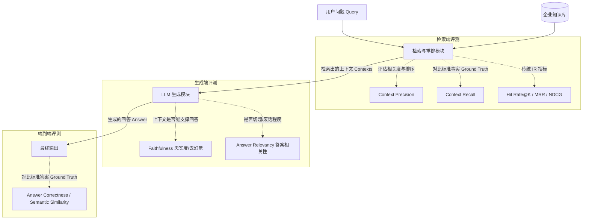
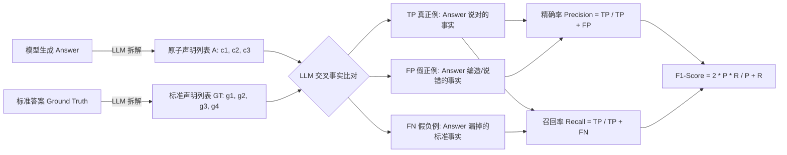
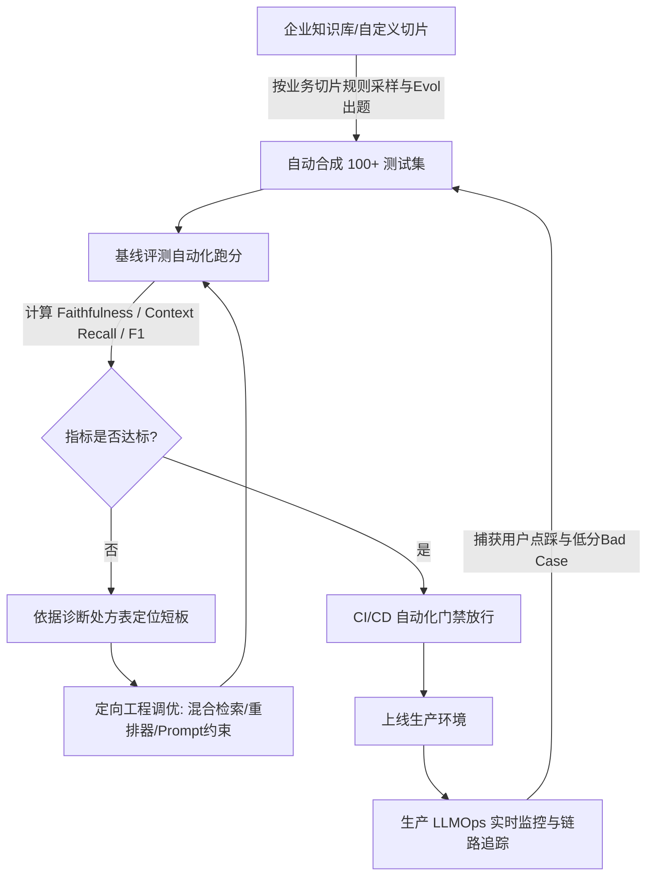

# 深入浅出 RAG 工业级评估体系与指标量化指南

> **文档定位**：系统性梳理检索增强生成（RAG）系统的评估哲学、评测指标（Ragas、传统 IR 指标）、原子事实级 F1 分数深度算法、合成测试集低成本构建机制、指标驱动的定向优化处方以及生产级 LLMOps 监控治理体系。

---

## 目录
1. [RAG 评估哲学：从经验主义到量化科学](#一rag-评估哲学从经验主义到量化科学)
2. [RAG Triad（三元组）黄金评估模型](#二rag-triad三元组黄金评估模型)
3. [核心评估指标深度剖析（Ragas + 经典信息检索）](#三核心评估指标深度剖析ragas--经典信息检索)
4. [深度剖析：为什么大模型评估必须引入原子事实级 F1 分数？](#四深度剖析为什么大模型评估必须引入原子事实级-f1-分数)
5. [综合评估打分与平衡决策策略](#五综合评估打分与平衡决策策略)
6. [合成测试数据集自动生成（Synthetic Testset Generation）与成本精算](#六合成测试数据集自动生成synthetic-testset-generation与成本精算)
7. [指标驱动的定向优化路线图（诊断与调优处方表）](#七指标驱动的定向优化路线图诊断与调优处方表)
8. [生产级 LLMOps 监控与 FinOps 成本治理](#八生产级-llmops-监控与-finops-成本治理)

---

## 一、RAG 评估哲学：从经验主义到量化科学

在 RAG 系统的开发初期，开发者往往依赖“肉眼观察”（Eyeball Test）：输入十几个问题，肉眼扫一遍回答，感觉“大差不差”就认为优化成功。但在企业级生产环境中，这种做法存在巨大隐患：
- **回归盲区（Regression）**：修改了 Chunk 切片规则可能修复了 3 个问题，却默默破坏了其他 50 个问题的检索召回；
- **评估错位（Blame Misplacement）**：当回答出现错误时，无法快速界定是**检索召回漏了（Retrieval Failure）**、**重排器排偏了（Ranking Failure）**，还是**大模型自身产生幻觉（Generation Failure）**；
- **缺乏上线红线（Gatekeeping）**：没有可量化的自动化阈值阻断缺陷模型或配置推向生产。

现代 RAG 评估的核心思想是：**“分治法（Divide and Conquer）”与“无监督/LLM-as-a-Judge 自动化”**，将复杂的端到端链路拆解为可独立度量的环节。



---

## 二、RAG Triad（三元组）黄金评估模型

由 TruLens 和学术界广泛认可的 **RAG Triad（三元组）**，是评估无需真实答案标注（Ground Truth-Free）的最强利器，覆盖交互的三个核心边：

```
                    Query (用户问题)
                      /          \
                     /            \
  [1. Context Relevance]        [3. Answer Relevance]
                   /                \
                  /                  \
        Retrieved Context ------------ Answer (模型回答)
                     [2. Faithfulness]
```

1. **Context Relevance（上下文相关性 / 检索精度）**：
   - **度量目标**：检索出来的切片是否真正与用户的 Query 相关？
   - **痛点**：如果检索返回了 5 篇无关的长篇大论，不仅浪费昂贵的 Token，还会引入噪声干扰生成（Lost in the Middle 现象）。
2. **Faithfulness（忠实度 / 去幻觉）**：
   - **度量目标**：模型生成的每一句话、每一个事实陈述，能否从检索到的 Context 中推导出来？
   - **痛点**：企业核心风控红线。模型绝对不能在上下文未说明的情况下“脑补”或“胡编乱造”。
3. **Answer Relevance（答案相关性）**：
   - **度量目标**：模型生成的 Answer 是否直接回答了用户的问题，而不是东拉西扯、打太极？
   - **痛点**：防止回答虽忠实于上下文，但跑题或只字不提用户核心关切。

---

## 三、核心评估指标深度剖析（Ragas + 经典信息检索）

以业界事实标准框架 **Ragas** 与经典信息检索（IR）为基准，完整评估指标体系如下：

### 1. 检索阶段指标（Retrieval Metrics）

| 指标名称 | 是否需要 Ground Truth | 计算核心逻辑 | 工业基线健康线 |
| :--- | :--- | :--- | :--- |
| **`context_precision`** | 是（标注文档/片段） | 衡量检索到的相关切片是否优先排在最前列（加权排序精度，类似 mAP）。排名靠前的切片越相关，分数越接近 1.0。 | $\ge 0.80$ |
| **`context_recall`** | 是（标准答案所引事实） | 衡量 Ground Truth 中涉及的所有核心事实片段，有多少比例成功被检索到的 Contexts 所捕获。 | $\ge 0.85$ |
| **Hit Rate@K** | 是 | 在检索返回的 Top-K 个切片中，是否存在至少一个命中标准事实相关切片。命中即为 1，未命中为 0。 | $\text{Hit@3} \ge 0.85$ |
| **MRR (Mean Reciprocal Rank)** | 是 | 评估第一个相关切片出现的排名倒数。若首个命中在第 1 位则得分 1，在第 2 位得 0.5，以此类推。 | $\ge 0.75$ |
| **NDCG@K (归一化折损累计增益)** | 是（分级相关度） | 不仅考虑是否命中，更严格惩罚将高相关切片排在低位的情况（按 $\log_2(rank+1)$ 衰减）。 | $\ge 0.82$ |

### 2. 生成阶段指标（Generation Metrics）

| 指标名称 | 是否需要 Ground Truth | 计算核心逻辑 | 工业基线健康线 |
| :--- | :--- | :--- | :--- |
| **`faithfulness`** (忠实度) | **否** | 将生成的回答拆分为原子事实声明（Statements/Claims），逐条使用 LLM 检验：该声明能否从 Context 推导？公式：$\frac{\text{被支撑的事实声明数}}{\text{总事实声明数}}$。 | $\ge 0.90$（风控级 $\ge 0.95$） |
| **`answer_relevancy`** (答案相关度) | **否** | 基于生成的 Answer，利用 LLM 反向推导生成多组虚拟 Query，计算这些虚拟 Query 与真实 Query 之间的 Embedding 余弦相似度。越相关分越高。 | $\ge 0.85$ |

### 3. 端到端指标（End-to-End Metrics）

| 指标名称 | 是否需要 Ground Truth | 计算核心逻辑 | 工业基线健康线 |
| :--- | :--- | :--- | :--- |
| **`answer_correctness`** (答案准确度) | **是** | **语义相似度 + 事实 F1 分数的复合加权**。不仅考察用词是否相近，更严格核算与标准答案相比，事实是多了、漏了还是对了。 | $\ge 0.85$ |
| **`answer_similarity`** (语义相似度) | **是** | 纯向量余弦相似度（Cosine Similarity），评估 Answer 与 Ground Truth 向量表征的余弦距离。 | $\ge 0.88$ |

---

## 四、深度剖析：为什么大模型评估必须引入原子事实级 F1 分数？

### 1. 传统向量相似度（Cosine Similarity）的严重缺陷

很多初学者直接用 `cosine_similarity(Embedding(Answer), Embedding(Ground_Truth))` 评估生成效果，但这在专业级场景下是极其危险的：
- **否定词盲区**：“我们支持无理由退款”与“我们**不**支持无理由退款”，语义向量相似度常高达 **0.95+**，但业务含义完全颠覆！
- **数值与实体盲区**：“赔付金额为 1000 元”与“赔付金额为 10000 元”，向量只相差几个微小维度，相似度极高，但造成严重业务资损。
- **偷懒与答非所问盲区**：模型回答一段又长又华丽的废话，只字未提核心参数，向量距离却可能因为上下文同属一个领域而偏高。

### 2. 什么是原子事实级 F1 分数（Fact/Claim F1-Score）？

Ragas 在计算 `answer_correctness` 时，采用的是基于**命题/事实声明（Atomic Claims/Statements）**的分类统计法：



#### 实战案例拆解：
- **标准答案 (Ground Truth)**：
  > “本系统支持 TiDB 和 MySQL，默认端口分别是 4000 和 3306，数据采用 AES-256 加密。”
  - 包含 3 个标准事实：
    - $g_1$: 支持 TiDB (4000) 与 MySQL (3306)
    - $g_2$: 默认端口分别为 4000 和 3306
    - $g_3$: 采用 AES-256 加密

- **场景 A（模型偷懒漏答）**：
  > 模型回答：“本系统支持 TiDB 和 MySQL。”
  - 声明：$c_1$: 支持 TiDB 和 MySQL（正确，**TP = 1**）
  - 错误事实：无（**FP = 0**）
  - 遗漏事实：未提端口（$g_2$ 漏），未提 AES-256（$g_3$ 漏）（**FN = 2**）
  - 精确率 $P = \frac{1}{1+0} = 1.0$（看查准率以为它很完美！）
  - 召回率 $R = \frac{1}{1+2} = 0.33$
  - **$F_1 = \frac{2 \times 1.0 \times 0.33}{1.0 + 0.33} = 0.50$（准确暴露出漏答缺陷）**

- **场景 B（模型胡蒙乱猜）**：
  > 模型回答：“本系统支持 TiDB、MySQL 和 Oracle，采用 AES-256 与 RSA-2048 双重加密，端口需要向管理员申请。”
  - 命中事实：$g_1$ 对了一半，$g_3$ 命中（**TP = 1.5**）
  - 编造事实：Oracle（胡编）、RSA-2048（胡编）、端口申请（胡编）（**FP = 3**）
  - 遗漏事实：未给出默认端口数字（**FN = 1**）
  - 精确率 $P = \frac{1.5}{1.5 + 3} = 0.33$（极低，有效惩罚了幻觉）
  - **$F_1$ 迅速被拉低至 0.40 以下**。

**结论**：
> **F1 分数是大模型评测中的“测谎仪与防偷懒器”**。只有既“不胡言乱语”（High Precision）又“完整交代细节”（High Recall），才能拿到高分。

---

## 五、综合评估打分与平衡决策策略

在评估报告输出时，不能只看单一平均值，通常采用三级平衡决策体系：

### 1. 检索端调和平均（Retrieval F1）
在评估检索器切片粒度时，单纯切得太大（Recall 极高但杂质多、Precision 低）或切得太小（Precision 高但信息支离破碎、Recall 低）都会导致生成翻车：
$$\text{Retrieval } F_1 = \frac{2 \times \text{context\_precision} \times \text{context\_recall}}{\text{context\_precision} + \text{context\_recall}}$$
- 如果 Retrieval $F_1 < 0.75$，说明检索召回骨干网络不稳定，必须先调切片策略与混合检索，暂不要折腾 Prompt。

### 2. 生产业务加权综合评分（Composite Quality Score）
根据业务偏好定义权重矩阵：
$$\text{Score} = w_1 \cdot \text{Faithfulness} + w_2 \cdot \text{Context Recall} + w_3 \cdot \text{Answer Relevancy} + w_4 \cdot \text{Answer Correctness}$$

- **金融 / 医疗 / 司法合规场景（零容忍幻觉）**：
  $$\text{Score}_{\text{strict}} = 0.40 \times \text{Faithfulness} + 0.30 \times \text{Answer Correctness} + 0.15 \times \text{Context Recall} + 0.15 \times \text{Answer Relevancy}$$
- **泛客服 / 知识问答体验场景（注重流畅与体验）**：
  $$\text{Score}_{\text{customer}} = 0.25 \times \text{Faithfulness} + 0.25 \times \text{Answer Relevancy} + 0.30 \times \text{Answer Correctness} + 0.20 \times \text{Context Precision}$$

### 3. CI/CD 红线门禁（Hard-Gate Rules）
代码或知识库提交合并时，必须满足“绝对否决制”规则：
```python
# 生产 CI/CD 流水线门禁伪代码
def validate_eval_gate(metrics: dict) -> bool:
    # 规则 1：忠实度绝对红线（严防幻觉）
    if metrics["faithfulness"] < 0.90:
        raise CIValidationError("❌ 严重警告：模型忠实度跌破 0.90，存在严重幻觉风险！")
        
    # 规则 2：召回及格线
    if metrics["context_recall"] < 0.80:
        raise CIValidationError("❌ 检索召回率不足 0.80，知识覆盖缺失！")
        
    # 规则 3：零分题占比不可超过 3%
    zero_score_ratio = metrics["zero_score_count"] / metrics["total_cases"]
    if zero_score_ratio > 0.03:
        raise CIValidationError("❌ 完全解答失败的用例超过 3%！")
        
    return True
```

---

## 六、合成测试数据集自动生成（Synthetic Testset Generation）与成本精算

高质量评测的前提是必须有一批具有代表性的（Query, Ground_Truth, Contexts）测试用例。人工标注成本极其昂贵（一条工业标准问答标注成本在 5~15 元人民币），业界普遍采用 **Ragas + Evol-Instruct 自动演化合成测试集**。

### 1. Evol-Instruct 自动出题题型分类
Ragas 出题并非简单把文档让 LLM 总结成一问一答，而是通过演化提示词（Evol-Instruct）生成不同难度层次的题目：
1. **Simple Reasoning（单跳简单事实题，占比 ~50%）**：
   - 随机抽取 1 个高信息密度 Chunk。
   - 要求：“基于该段内容，生成一个具体针对某个参数、步骤或概念的具体问题和标准答案”。
2. **Multi-Context Reasoning（跨切片多跳推理题，占比 ~30%）**：
   - 向量检索或语义关联挑选 2~3 个相互关联但分散的 Chunk（如“方案A的设计”与“方案B的对比”）。
   - 要求：“生成一个必须同时结合这 2 篇切片才能回答的对比分析题”。
3. **Reasoning / Conditional（条件推理 / 假设题，占比 ~20%）**：
   - 要求：“基于该规章制度，构造一个特定业务违约/临界场景的用户提问，并根据规则推导出处罚或处理方案”。

### 2. 真实 Token 成本精算表（为什么十几万字只需不到 1 块钱？）

> **核心原理误区澄清**：
> 很多人误以为生成 100 道题需要让大模型把整本十几万字的小说/技术文档反复读 100 遍，那将消耗几千万 Token。
> **事实完全不是这样！** Ragas 采用的是**分块采样（Chunk Sampling）**机制。

| 步骤 | 操作逻辑 | 每次操作消耗 Token | 100 道题累计消耗 Token | 费用核算（按 DeepSeek-V3 1元/百万Token） |
| :--- | :--- | :--- | :--- | :--- |
| **步骤 1：文档解析与清洗** | 本地 Python 执行切片，不调用 LLM | 0 Token | 0 Token | **0.00 元** |
| **步骤 2：切片过滤与选择** | 本地计算信息熵/关键词密度，筛选合格 Chunk | 0 Token | 0 Token | **0.00 元** |
| **步骤 3：单跳出题（50题）** | 每次仅送入 1 个 Chunk（约 400 Token）出题 | 输入 600，输出 250 | 输入 3 万，输出 1.25 万 | **约 0.05 元** |
| **步骤 4：多跳出题（30题）** | 每次送入 2 个关联 Chunk（约 800 Token）推理 | 输入 1000，输出 350 | 输入 3 万，输出 1.05 万 | **约 0.05 元** |
| **步骤 5：演化加深（20题）** | 将简单问题重写增加干扰项与边界条件 | 输入 500，输出 200 | 输入 1 万，输出 0.4 万 | **约 0.02 元** |
| **步骤 6：质检与过滤（Critic）** | 检验生成的问答是否清晰无歧义 | 输入 600，输出 50 | 输入 6 万，输出 0.5 万 | **约 0.07 元** |
| **合计汇总** | **完整构建 100 道高质量基准题** | - | **总计约 14.8 万 Token** | **合计约 0.19 ~ 0.35 元** |

> [!TIP]
> 耗时方面：利用 `asyncio` 并发调用大模型 API（并发度 10~20），生成 100 道高质量黄金测试集连同标准答案，**通常耗时在 3~8 分钟以内，总 API 成本不到 5 毛钱人民币**。

---

## 七、指标驱动的定向优化路线图（诊断与调优处方表）

当评估指标出炉后，如何科学地定位瓶颈并针对性调优？请参考下表“对症下药”：

```
                ┌───────────────────────────────────┐
                │        评估指标测试结果出炉         │
                └─────────────────┬─────────────────┘
                                  │
         ┌────────────────────────┴────────────────────────┐
         ▼                                                 ▼
【检索端指标偏低】                                 【生成端指标偏低】
├─ Context Precision 偏低                           ├─ Faithfulness 偏低 (幻觉严重)
│  └─ 处方: 引入 Reranker 重排 / 加及格线截断         │  └─ 处方: 温度设为0 / 强化负向Prompt / 强制引文标注
├─ Context Recall 偏低                              ├─ Answer Relevancy 偏低 (跑题/废话)
│  └─ 处方: BM25混合检索 / Query扩展 / 扩大重叠窗口   │  └─ 处方: Few-Shot范例规范 / 限制输出最大Token
```

### 详细诊断与优化实施手册：

| 异常指标特征 | 根本原因定位 | 具体技术架构与代码优化手段 |
| :--- | :--- | :--- |
| **`context_precision` 严重偏低**<br>（检索返回前列包含大量噪音） | 1. 向量模型未考虑细粒度交互<br>2. 默认 Top-K 机械式取满，未设绝对距离截断<br>3. 切片尺寸（Chunk Size）过大（如 1500+） | 1. **引入重排器（Cross-Encoder Reranker）**：如 BGE-Reranker-Large，将粗筛 Top-20 重排为精细 Top-3；<br>2. **实施及格线过滤**：过滤距离阈值或相关度打分（例如余弦相似度 $<0.65$ 或 L2 距离 $>500$ 的直接抛弃）；<br>3. **切片微细化**：缩减 Chunk 大小至 400~600，配合 Parent Document 机制。 |
| **`context_recall` 严重偏低**<br>（标准事实未能被召回） | 1. 语义断层：用户口语与文档专业术语差异大<br>2. 切片边界截断了完整上下文<br>3. 单路向量检索覆盖不全 | 1. **混合检索（Hybrid Search）**：向量检索 + BM25 稀疏检索按 0.6 : 0.4 加权融合（RRF 倒数排名融合）；<br>2. **Query 扩展与重写**：在检索前让 Agent 执行 Query Rewriting 或生成 3 个同义检索词多路检索；<br>3. **增大重叠滑动窗口**：将 `chunk_overlap` 从 20 提高至 100~150 Token。 |
| **`faithfulness` 偏低**<br>（模型开始凭空捏造） | 1. 模型温度设置过高<br>2. 系统提示词约束力弱<br>3. 模型在知识库无答案时盲目发挥 | 1. **冻结采样温度**：问答场景将 `temperature` 调整为 `0.0` 或 `0.1`；<br>2. **强化负向硬约束**：“仅依据提供的上下文材料回答。如果材料中未提及，请明确回复‘知识库未收录相关信息’，严禁推测”；<br>3. **强制 Citation 结构化输出**：要求每个结论标注来源切片编号 `[Doc-1]`。 |
| **`answer_relevancy` 偏低**<br>（回答冗长、绕弯子、未击中靶心） | 1. 提问意图模糊<br>2. 模型输出格式失控<br>3. 上下文过长导致 Lost in the Middle | 1. **Few-Shot 提示词示范**：在 System Prompt 注入 2 个“结论先行 + 核心参数列出”的标杆样例；<br>2. **意图路由（Router）前置**：在 RAG 前先做 Intent Classification，针对参数查询类直接限定输出格式。 |

---

## 八、生产级 LLMOps 监控与 FinOps 成本治理

评测不仅仅在离线发版时进行，更需要在线对每一次真实用户调用进行全链路追踪和性能监控。

### 1. 核心工业级 SLA 监控指标
- **TTFT (Time To First Token，首字延迟)**：用户从点击发送到屏幕打出第一个字的时间，直接影响用户体验心理（目标 $\le 800\text{ms}$）。
- **E2E Latency (端到端总延迟)**：完整回答生成结束的总耗时（目标 $\le 3000\text{ms}$）。
- **Token 吞吐量 (TPS - Tokens Per Second)**：大模型生成速度（目标 $\ge 25 \text{ tokens/s}$）。
- **Token 消费与成本统计**：每次请求的 Prompt Tokens、Completion Tokens 及转换成的计费金额。

### 2. 代码级 Token 精确捕获实践（以 FastAPI 为例）

```python
import time
from fastapi import FastAPI, Request
from openai import AsyncOpenAI

app = FastAPI()
client = AsyncOpenAI(api_key="your_api_key", base_url="https://api.deepseek.com")

@app.post("/api/chat")
async def chat_endpoint(user_query: str):
    start_time = time.perf_counter()
    first_token_time = None
    
    # 模拟检索与拼装 Prompt
    contexts = ["切片 1 内容...", "切片 2 内容..."]
    prompt = f"参考材料：\n{chr(10).join(contexts)}\n\n问题：{user_query}"
    
    # 流式调用并精确捕获性能指标
    response = await client.chat.completions.create(
        model="deepseek-chat",
        messages=[{"role": "user", "content": prompt}],
        stream=True,
        stream_options={"include_usage": True}  # 关键：要求返回准确 Token 统计
    )
    
    total_tokens = 0
    prompt_tokens = 0
    completion_tokens = 0
    full_content = []
    
    async for chunk in response:
        # 记录首字延迟
        if first_token_time is None and chunk.choices and chunk.choices[0].delta.content:
            first_token_time = time.perf_counter() - start_time
            
        if chunk.choices and chunk.choices[0].delta.content:
            full_content.append(chunk.choices[0].delta.content)
            
        # 获取最终用量统计
        if hasattr(chunk, "usage") and chunk.usage:
            prompt_tokens = chunk.usage.prompt_tokens
            completion_tokens = chunk.usage.completion_tokens
            total_tokens = chunk.usage.total_tokens

    end_time = time.perf_counter()
    e2e_latency = end_time - start_time
    
    # 记录监控指标并打点上报
    metrics = {
        "ttft_ms": round((first_token_time or 0) * 1000, 2),
        "e2e_latency_ms": round(e2e_latency * 1000, 2),
        "prompt_tokens": prompt_tokens,
        "completion_tokens": completion_tokens,
        "total_tokens": total_tokens,
        "estimated_cost_cny": (prompt_tokens * 1.0 + completion_tokens * 2.0) / 1000000,  # 预估成本
    }
    
    # 可直接推送至 Prometheus / Langfuse / OpenTelemetry
    print(f"📊 [LLMOps 监控上报] {metrics}")
    
    return {"reply": "".join(full_content), "metrics": metrics}
```

### 3. 可观测性监控看板集成（Langfuse / LangSmith）

在生产环境中，推荐接入开源链路追踪系统（如 **Langfuse**），实现可视化全流程透视：
1. **Trace 级追踪**：一条用户请求点击展开，可清晰看到：
   - 意图识别耗时与 Token；
   - 向量检索耗时、检索得分、切片原始文本；
   - Reranker 重排前后的排名变动；
   - LLM 生成的 Prompt 详细构筑与 Token 消耗。
2. **在线反馈打分（User Feedback Loop）**：
   - 将用户前端的“点赞 👍 / 点踩 👎”事件回传，与离线评估得分建立相关性模型；
   - 自动沉淀“点踩”恶性 Bad Case，直接入库进入待分析评估队列。

---

## 九、总结：RAG 工业评测闭环全景图

完整的 RAG 工程优化绝不是盲目的试错，而是一个具备自我进化能力的**数据飞轮（Data Flywheel）**：



通过这套**“可度量、可溯源、可干预、低成本”**的评估与监控体系，团队能够以极高的确定性和工程自信，持续推动 RAG 系统的性能迭代与降本增效。
